QuickrBasic
-----

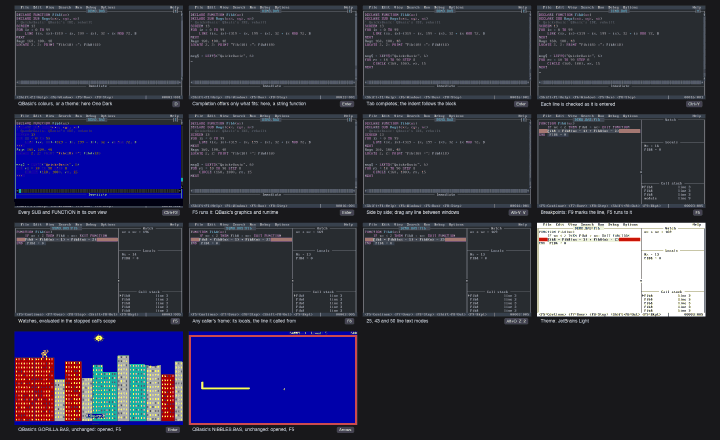

**A modern remake of QBasic, QuickBasic and VBDos.** The blue screen you grew up with, rebuilt from
scratch in C23. It opens GORILLA.BAS and NIBBLES.BAS unchanged, and runs BASIC 3.3× faster
than QBasic 1.1 on the same CPU.

**[Try it in your browser](https://ali-mosavian.github.io/QuickrBasic/)**: the IDE, compiled to
WebAssembly, with GORILLA.BAS and NIBBLES.BAS ready to open. On a Mac with Apple silicon and macOS 15 or later,
**[download QuickrBasic.app](https://github.com/ali-mosavian/QuickrBasic/releases/download/mac-latest/QuickrBasic-mac-arm64.zip)**: it is not notarized, so open it the first time with
right-click, Open.

Type a line and it is checked as you enter it, highlighted by the compiler's own lexer, and
completed with only what fits where the cursor is. Press F5 and it runs. Press F9 and it stops
there, with your locals, watches and the whole call stack one keypress away.

Split the editor into two windows on the same program and drag lines between them. Pick one of
nine themes: QBasic's classic blue, One Dark, Ayu, Gruvbox and JetBrains, dark and light. Switch
between 25, 43 and 50 lines.

No 64 KB walls. Programs, lines, strings, arrays and symbol tables grow until memory runs out.

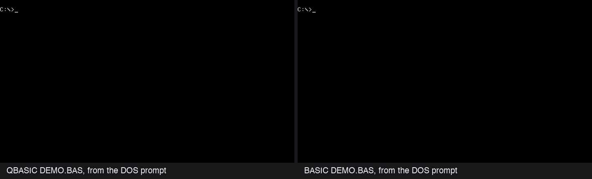

## What QBasic never had

| | QBasic 1.1 | QuickrBasic |
|---|---|---|
| Speed | 1× | **3.3×**, up to 34× ([below](#how-fast)) |
| `INTEGER` | 16-bit: 32767 + 1 overflows | **32-bit**, the machine's own; `INTEGER` and `LONG` are one type |
| 16-bit integers | the only kind | **`SHORT` and `DEFSHORT`**, for records laid out as QBasic's |
| Memory | 64 KB segments | **all of it**: everything grows as needed |
| Syntax highlighting | none | from the compiler's lexer, so it never disagrees with it |
| Completion | none | **context-aware**: only what is valid where the cursor is |
| Breakpoints | F9 | F9; they move with their line |
| Stepping | Step, Procedure Step | Step, Step Over, **Step Out** |
| Watches | none | in **any frame** on the call stack |
| Locals, call stack | none | **a debug pane**: Watch, Locals, Call stack |
| Editor | one split | split windows; drag any line between them |
| Look | colours set by hand | **nine themes** |
| Platforms | DOS | DOS, macOS and the browser today; Linux and Windows on the way ([below](#platforms)) |

## How fast

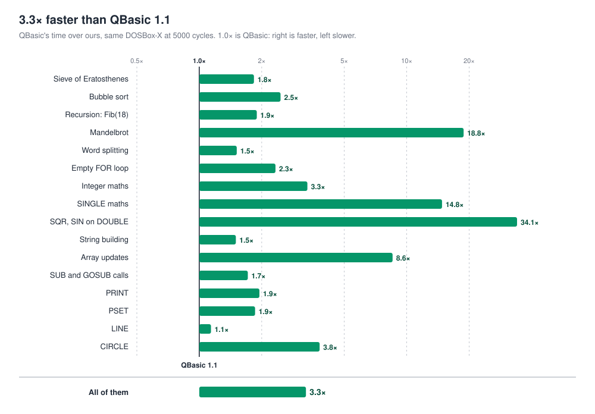

QBasic 1.1 and QuickrBasic's IDE run the same `BENCH.BAS` in the same DOSBox-X at a fixed 5000
cycles, so the CPU is identical. The first five are whole programs: a prime sieve, a sort,
recursion, a Mandelbrot set and word splitting. `python3 tools/bench.py qbasic --json F` runs it
again, and `tools/diagrams/speed.py` draws this chart from it.

Programs compile line by line to compact bytecode for a register-cached stack VM: constants fold,
common operands are folded into the op, and common sequences fuse into one op. See
[docs/architecture.md](docs/architecture.md).

## Every feature, one by one

| | |
|---|---|
| **From DOS**: `basic demo.bas`; highlighting from the compiler's lexer<br>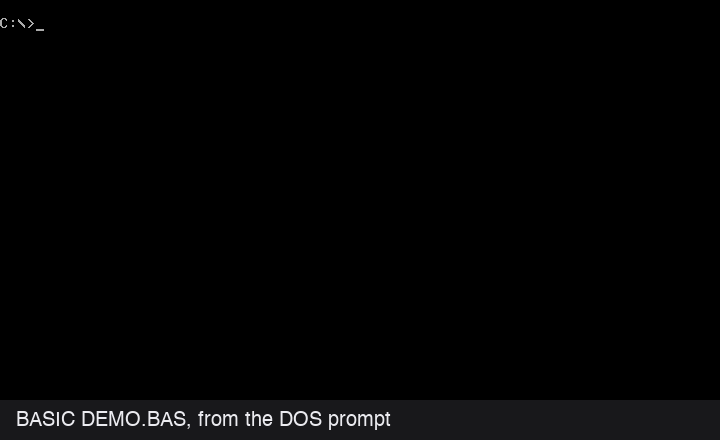 | **Completion** offers only what fits where the cursor is<br>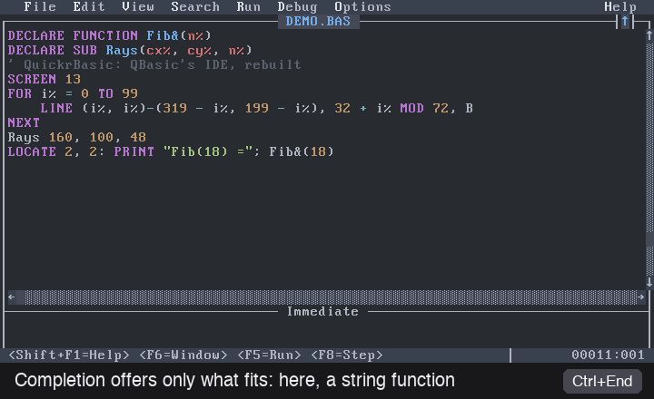 |
| **Tab completes**; the indent follows the block<br>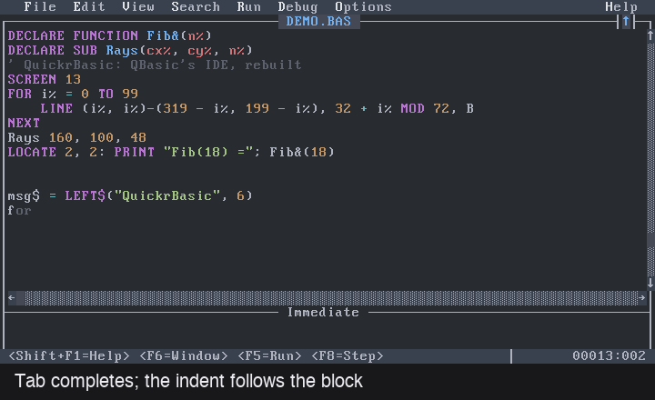 | **Each line checked** as it is entered<br>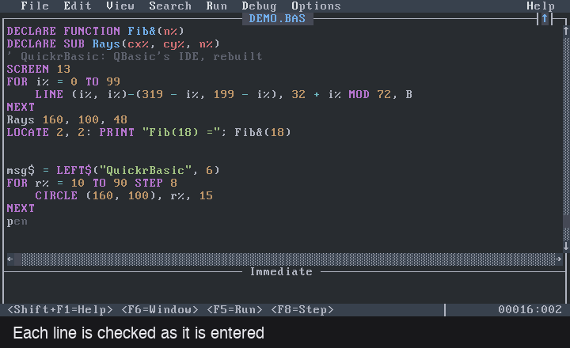 |
| **SUBs and FUNCTIONs**, each in its own view<br>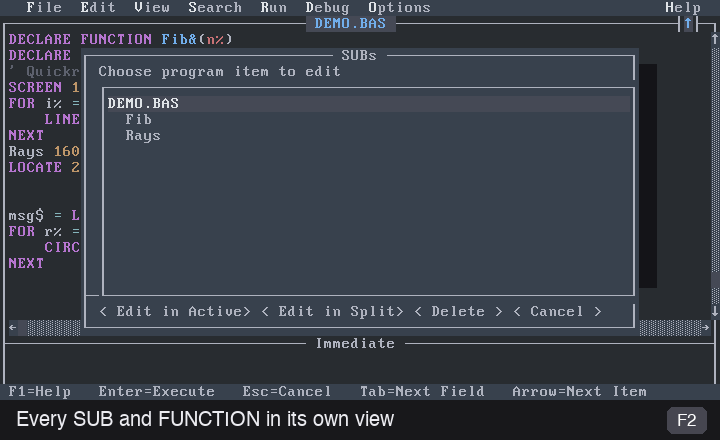 | **QBasic's runtime**: graphics, sound, files<br>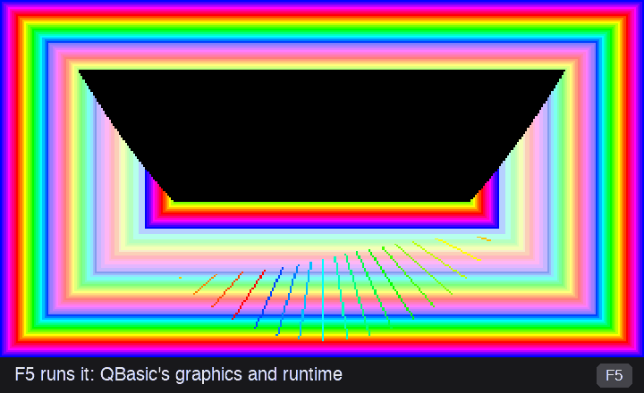 |
| **Split windows**; drag any line between them<br>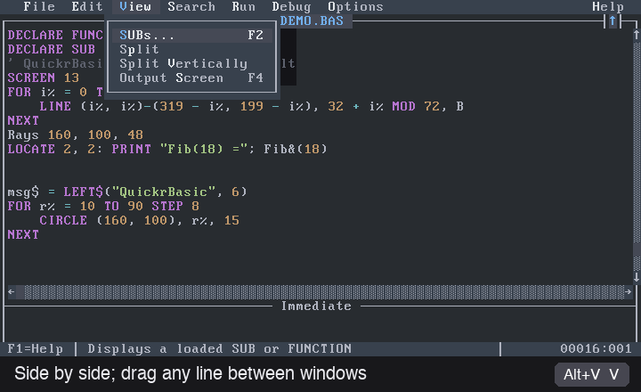 | **Breakpoints**, stepping, Locals<br>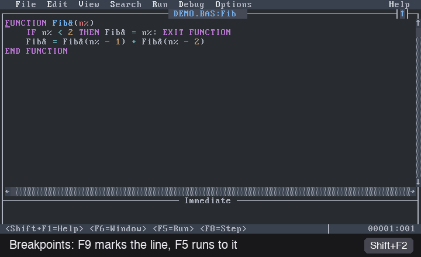 |
| **Watches** in the stopped call's scope<br>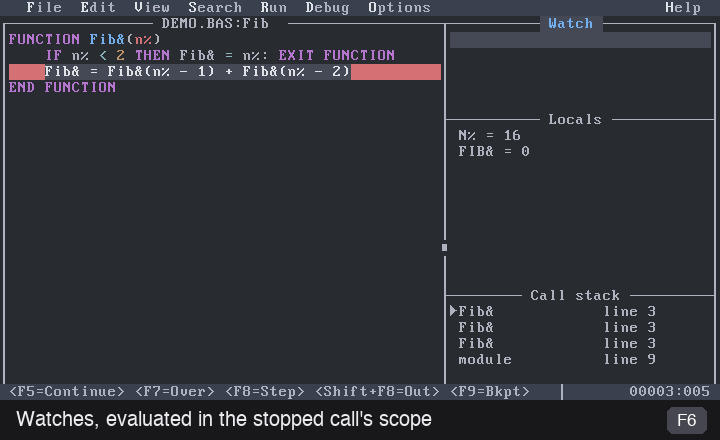 | **The call stack**: any caller's frame<br>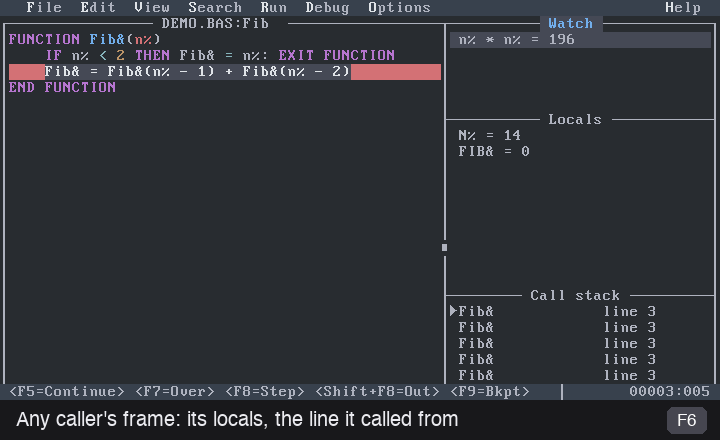 |
| **25, 43 and 50 lines**<br>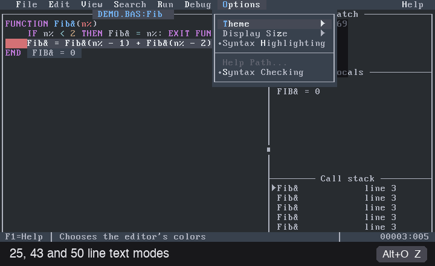 | **Nine themes**<br>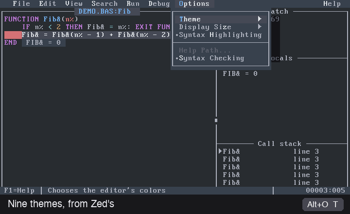 |
| **GORILLA.BAS**, unchanged, opened and run<br>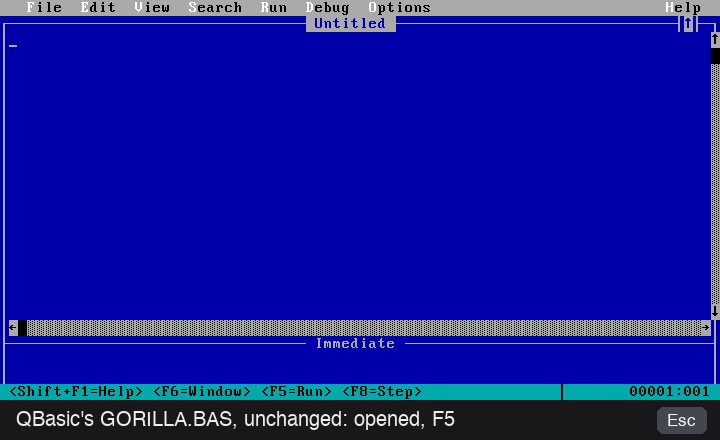 | **NIBBLES.BAS**, unchanged, opened and run<br>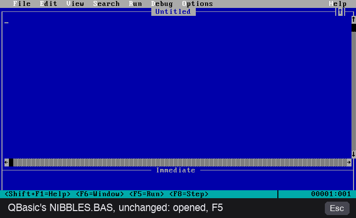 |

The clips are DOSBox-X's own video capture of the real IDE: `python3 tools/demo.py`.

## Platforms

One core, one platform layer per system (`src/plat`):

| System | Build | Compiler and runtime | IDE |
|---|---|---|---|
| DOS | 32-bit, DOS/32A | ✅ | ✅ |
| macOS | 64-bit, arm64 and x86-64; the IDE an app, Apple silicon ([download](https://github.com/ali-mosavian/QuickrBasic/releases/download/mac-latest/QuickrBasic-mac-arm64.zip)) | ✅ | ✅ |
| Linux | 64-bit | 🚧 | 🚧 |
| Windows | 32- and 64-bit | 🚧 | 🚧 |
| Browser | WebAssembly ([live](https://ali-mosavian.github.io/QuickrBasic/)) | ✅ | ✅ |

## Getting started

Needs clang, make, python3, git and a C compiler. Everything else is built from pinned sources on
first use (`tools/deps.sh`, into `build/deps`) or is in `third_party/`.

```sh
make            # build/c/: BASIC32.EXE, IDE32.EXE, DOS32A.EXE, BASIC.HLP
make test       # the regressions and QB 4.5 conformance under DOSBox-X
make host       # the same core for this machine: build/host/basic
make host-test  # unit tests, golden bytecode and the suites, natively, in seconds
make web        # build/web/: the browser IDE; serve it with python3 tools/wasm/serve.py build/web
make mac        # build/mac/QuickrBasic.app: the IDE in a window (needs SDL 3: brew install sdl3)
```

Copy `IDE32.EXE` (or `BASIC32.EXE`), `DOS32A.EXE` and `BASIC.HLP` to a DOS machine, or DOSBox, and
run `IDE32 PROGRAM.BAS`.

- `GCC=1` builds with i686-elf-gcc instead; `make lto` optimizes the whole program as one module.
- `src/`: the C. [docs/architecture.md](docs/architecture.md): how it fits together.
- `retired/`: the 32-bit and 16-bit assembly QuickrBasic was ported from, still buildable
  (`make -C retired/asm32`, `make -C retired/asm16`).

## Licence

[GNU AGPL-3.0](LICENSE), with one added term ([NOTICE](NOTICE)): a work based on QuickrBasic keeps
the credit "Based on QuickrBasic by Ali Mosavian", with a link here.

Third-party parts keep their own licences:

- DOS/32A (`third_party/dos32a`, its licence beside it). This product uses DOS/32 Advanced DOS
  Extender technology.
- llrm's QB runtime (`src/qbrt/llrm`), DOS/32A start-up (`src/plat/dos32/startup`), and its QB
  conformance cases (`tests/qb45`, `tests/qbrun`).
- jwasm and jwlink, built from the pinned forks by `tools/deps.sh`.
