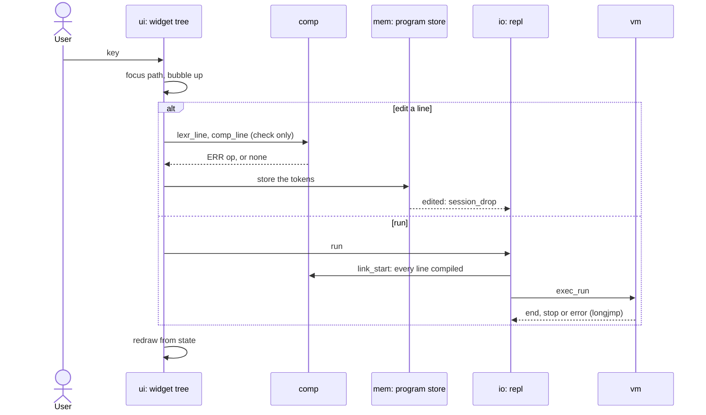
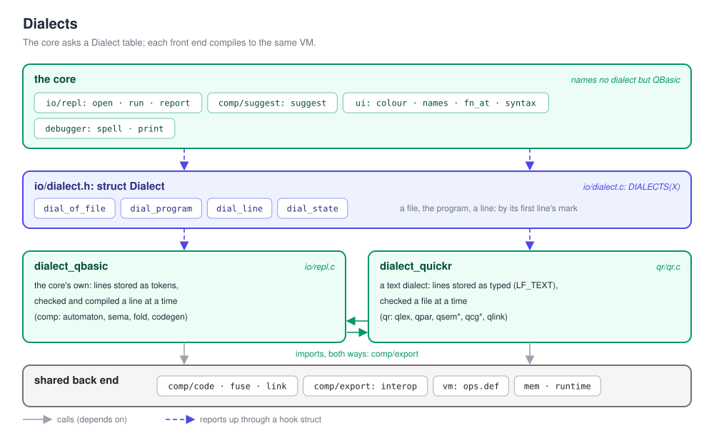
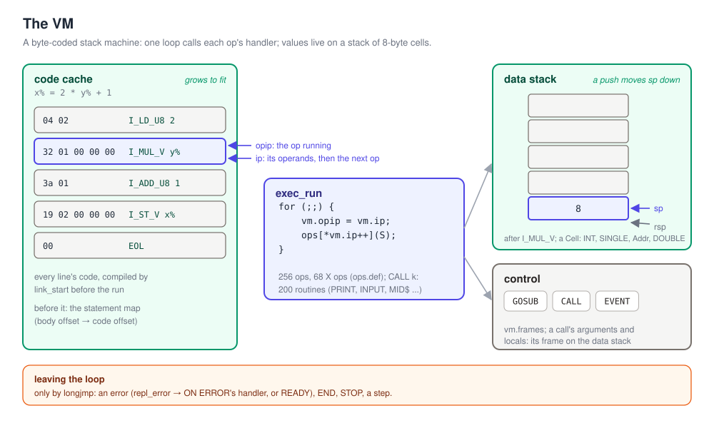
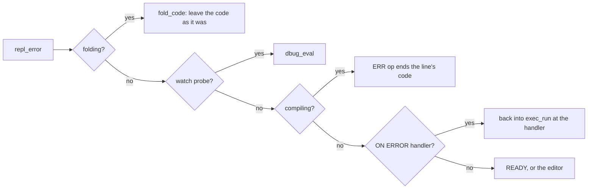

# QuickrBasic architecture

How `src/` is laid out and why. The C was ported from the asm in `retired/asm32`; each file's header
maps the asm it replaced.

## Goals

- **Clear ownership:** every piece of state has exactly one owner.
- **Clear flow:** you can follow any event from a key press to the result.
- **DRY:** each fact lives in one place.
- **SRP:** a module or function does one job.
- **Clean boundaries:** no mixing across them. See [Boundaries](#boundaries).
- **Open/closed:** a new statement, op, widget or dialect is a new entry, not an edit to a switch.
- **Small and simple:** the rules above apply only as far as they keep the code smaller and clearer.
- **Line at a time:** each line is checked as it is entered or edited.
- **Idiomatic C23:** `const` on everything that does not change, indexed `for` loops, named
  load/store helpers for word access. `make format` lays out every C file.
- **Same behaviour as QBasic 1.1:** output, errors, stored lines, bytecode and file records stay
  byte for byte with the retired asm; `make -C retired/asm32 test` runs the same suites on it.

## Layers


## Modules

| Directory | Owns | Does |
|---|---|---|
| `app` | the one `Session` | `basic32.c`, `ide32.c`: pick a `FrontEnd` and boot |
| `core/ui` | `uimn`, `them` | The IDE: widget tree, editor, windows, menus, dialogs, debug pane, highlighting, completion, themes |
| `core/session.c` | `Session` | Every module's state; the debugger's API |
| `core/comp` | `Lexr`, `Comp`, `Ast`, `Expr`, `Decl`, `Ctrl`, `Blok`, `Link`, `List`, `Code` | Lexer, statement automaton, steps and trees, `sema`, fold, codegen, op fusion, link, lister; a module's exports to the other dialect (`export.c`) |
| `core/vm` | `Vm`, `Flow`, `Dbug`, `Evnt`, `Chai`, `Usng`, `Syst`, `StmtState` | The loop, ops (`ops.def`), statements and functions, frames, events, CHAIN, PRINT USING, the debugger's stops |
| `core/io` | `Chnl`, `Cons`, `File`, `Repl`, `Srcr`, `Diag`, `Dial` | Channels, console, files, the READY loop, loading source, error messages; the dialects (`dialect.h`), QBasic's the core's own |
| `core/qr` | Quickr's state (`Dial`'s) | Quickr, a text dialect: its table (`qr.c`), lexer, parser, checker (`qsem*.c`), codegen (`qcg*.c`), link, runtime (`qrt.c`) |
| `core/mem` | `Allo`, `Arry`, `Prog`, `Scop`, `Strg`, `Symb` | The BASIC arena: its blocks, arrays, the program store, scopes, strings, symbols |
| `core/num` | `Rndm` | SINGLE and DOUBLE arithmetic, the maths functions, RND |
| `core/util` | none | Bump arenas for scratch, a free-list heap |
| `plat` | | The machine: screen, keys, mouse, clock, files, system, memory, FPU (`p????.h`) |
| `qbrt` | | llrm's QB runtime: graphics, sound, the console in graphics modes |
| `lib` | | The C library subset the DOS build links (`string.h`, `setjmp.h`) |

`plat/dos32` is the product. `plat/host` builds the same core for this machine, for the tests.

## Boundaries

Each stage does one job and hands the next a finished product. Nothing reaches across.

- **Parsing builds a tree and emits nothing.** Every operand, reference and call is a node,
  including record fields, elements, `VARPTR` and procedure calls.
- **Name resolution answers what a name is.** It returns a description: a variable, a record
  field's place, a procedure. It neither parses expressions nor emits.
- **The semantic pass makes the tree valid.** `sema_tree` resolves each name to the facts codegen
  needs and raises every type error. A tree that passed it compiles without error.
- **Folding rewrites the tree.** It never emits.
- **Codegen alone writes bytes.** `cg_tree(Code *, const Node *)`: a checked tree in, bytes out. No
  `Session`, no symbol table, no errors.
- **Quickr keeps the same stages:** `qlex`, `qpar` (a tree, nothing emitted), `qsem*` (every error),
  `qcg*` (bytes alone), `qlink`.
- **A function sits in one stage.** If it both parses and emits, split it.
- **Only top-level functions take the `Session`.** A REPL command, a statement driver or a UI event
  handler takes it and passes each module just its own state, e.g. `blok_find(Blok *, ...)`.
- **A function's name starts with its owner's prefix,** static ones too: `sema_`, `fold_`, `cg_`,
  `blok_`, `chnl_`.
- **Tables are allocated, not fixed.** Compile-time tables live in arenas and link by pointer. Ids
  stay only where they are stored, such as a variable's id in bytecode.

## Ownership


- `app` creates the one `Session`. Each module's state is one struct, a field of it. A function that
  reads or changes any of it takes `Session *S` first.
- Hot accessors take only the part they touch (`exec_push(&S->vm, c)`), so headers need not see the
  whole `Session`.
- The IDE's own state is `uimn` (`ui/ui.h`), beside the `Session`.
- A program's memory is the BASIC arena only. The C side's scratch, such as a statement's tree,
  comes from bump arenas (`util/arena.h`) freed all at once. No malloc in the core.
- The core never calls up into a front end. It reports through `FrontEnd` (`io/repl.h`) and
  `DebugHooks` (`vm/debug.h`), which the front end installs.
- The core names no dialect but QBasic, its own. It asks a program's, module's or line's `Dialect`
  (`io/dialect.h`), a table each dialect provides; `io/dialect.c` lists them.

## Flow



- Commands change state. Drawing reads state. Neither does the other's job.

## Line at a time

QBasic's lines; Quickr checks a file at a time (see [Dialects](#dialects)).


- An edited line is tokenized (`lexr_line`) and compiled for its syntax alone (`comp_line`). An
  error marks the line; the code is dropped and the tokens are stored.
- A statement is run by the generated automaton (`comp/dfa.h`, from `tools/gen_dfa.py`). Each
  action makes the statement's steps, checked as made; `comp_flush` folds and generates them when
  the statement ends. The tree is scratch, dropped within the call.
- Before a run, `link_start` pairs the blocks (FOR/NEXT, IF, SUB/FUNCTION), compiles every line
  into the code cache, sets each op's addressing mode and resolves every jump. A run compiles
  nothing but the direct line.
- `listing` turns a stored line back into text.

## Dialects



A dialect is a table of operations, `struct Dialect` (`io/dialect.h`). The core calls a dialect
only through its table. `io/dialect.c` lists the tables in `DIALECTS(X)`, QBasic's first.

- **QBasic's table is the core's own** (`io/repl.c`): its lines are stored as tokens and checked a
  line at a time.
- **Every other dialect is a text dialect:** its lines are stored as typed (`LF_TEXT`), so the
  editor, an error's place and the debugger still work line by line. Quickr's table is in
  `qr/qr.c`.
- **Which dialect:** a text dialect's file starts with its mark, such as
  `' OPTION DIALECT QUICKR`. `dial_of_file`, `dial_program` and `dial_line` read the mark from a
  path, the program's first record, or a line's file. A QBasic program's module of another dialect
  keeps a pointer to its table.
- **State:** a dialect's state is `Dial`'s, made on first use from the C side's heap. `Session`
  holds no dialect's types.
- **What the core asks:**

  | Need | Operations |
  |---|---|
  | Load and run | `open`, `read`, `link`, `go`, `run`, `report`, `message`, `errtext` |
  | Editor | `syntax`, `flag`, `colour`, `names`, `fn_at`, `imports`, `suggest` |
  | Debugger and Immediate | `direct`, `print`, `spell` |
  | Interop | `guest_read`, `guest_declare` |
  | State | `size`, `forget` |

  A null hook is one QBasic has none of. No hook runs per VM op.
- **One back end:** every dialect compiles to `ops.def` through `comp/code`, `fuse` and `link`,
  and runs on the same VM, frames, arena and runtime. A dialect's ops are new entries in
  `ops.def`, never a second VM.
- **Interop:** `comp/export.h` describes a module's procedures and records in the VM's types. Each
  front end exports its own modules and imports the other's. A QBasic program reads a module of
  another dialect through `guest_read`, then declares its exports through `guest_declare`, which
  sets the link's `LinkGuest` hooks. A call across is a plain `PCALL`, with no marshalling.

**A new dialect** is:

1. its front end in its own directory, compiling to `ops.def` through `comp/code`;
2. a `Dialect` table, `dialect_NAME`;
3. `X(NAME)` in `DIALECTS`;
4. for interop, its exports through `comp/export.h`.

It needs no edits to `repl.c`, `suggest.c` or `ui/`. Two gaps remain: `comp.guest` holds one
dialect's guest modules at a time, and some message keys still name Quickr
(`DG_DUPLICATE_DEFINITION_QUICKR`).

## The VM



The VM is a stack machine over byte code. `exec_run` is its one loop: it notes the op's place in
`vm.opip` and calls the op's handler. The handler reads its operands at `vm.ip`, moves `vm.ip` past
them or to a jump's target, and returns. The hottest ops (`vm/hot.h`) are inlined into the loop
with `ip` and `sp` in registers.

**Code.** The code cache holds each line's code: a statement map (each statement's body offset to
its code offset), then the ops. An op is one byte, then its operands; a variable is its 4-byte id.
The cache grows to fit the program.

**Values.** The data stack holds 8-byte `Cell`s: an INT, a SINGLE, an `Addr` or a DOUBLE. An op
pops its operands and pushes its result. At a statement's start `sp` is `rsp`, so the stack is
empty.


**Operand forms.** Common right operands are folded into the op, so `2 * y% + 1` is three ops
rather than five:

| Suffix | Operand | Example |
|---|---|---|
| none | the stack | `I_ADD` |
| `_V` | a variable's id | `I_MUL_V y%` |
| `_U8`, `_I16`, `_F32` | a literal | `I_ADD_U8 1` |
| `_A1`, `_A` | an array element: one or n subscripts | `I_LD_A1 a%` |

`I` ops work on INTs, `F` on SINGLEs, `D` on DOUBLEs, `L` on Quickr's longs and `S` on strings.
`CALL k` runs one of 200 routines (PRINT, INPUT, MID$ ...). `ops.def` defines all 256 one-byte ops
and 68 X ops: the less hot ones, `X` and a second byte, run through a second table.

**Fusion.** After codegen, `fuse_code` turns common sequences into one op: a store of a literal is
`I_SET_U8`, a loop's test and jump `I_JFC_V`, its step, test and jump `I_NEXT_UP` (Quickr's
`I_COUNT_UP`, which stops at an INT's last value).

**Control.** GOSUB, a SUB or FUNCTION call, and an event's handler each push a `Frame` on
`vm.frames`. A call's frame is on the data stack: its arguments above `vm.fp`, its locals below.
The frames and the data stack's segments grow from the heap's top as calls nest, memory their
only limit (`vm/stack.c`).
A FOR loop is no frame: it is plain loads, stores, a compare and a jump, its limit and step hidden
variables. Before fusion:

```text
FOR i% = 1 TO 3: total! = total! + i% / 2: NEXT
I_LD_U8 1 | I_ST_V i% | I_LD_U8 3 | I_ST_V lim | I_LD_U8 1 | I_ST_V step | I_LD_V i% | I_CMP_V lim > | I_JT → after NEXT
F_LD_V total! | F_LD_VI i% | F_DIV_U8 2 | F_ADD | F_ST_V total!
I_LD_V i% | I_STEP_V step | I_ST_V i% | I_LD_V i% | I_CMP_V lim > | I_JF → the body | EOL
```

**Stops and events.** The ops that end a statement or move between them (EOL, the jumps, GOSUB,
RETURN, ON, a procedure's return) check `vm.stop`. The platform sets it for Ctrl+Break and for the
timer tick that drives ON TIMER, ON KEY and the other events. In the IDE, a `DBG` op at each
statement's start is where steps, breakpoints and trace stop.

## Errors

A function that can fail returns a `Status` (`fault.h`). A runtime error is raised with
`repl_error`, which never returns: it unwinds with `longjmp` to the innermost catch, in this order:



A compile error is not raised at once: the ERR op raises it when the line runs, so an error in a
line the run never reaches does not stop it.

## Debugger

| Feature | `vm` | `session` | `ui` |
|---|---|---|---|
| Step, Step Over, Step Out | DBG op, stop modes, depth | `session_step(S, kind, stopped)` | F8, F7 or F10, Shift+F8 |
| Breakpoints, Clear All | `LF_BP` on the line | `session_arm` | F9 |
| Run to cursor | one-time stop line | `session_until` | Ctrl+F7 |
| Set Next Statement | moves the stopped run | `session_set_next` | menu |
| Restart | stops at the first statement | `session_step(S, STEP_INTO, false)` | menu |
| Trace | `DebugHooks.trace` per statement | `session_trace` | lights the statement |
| Continue | resumes from the stop | | F5 |
| Call stack, Locals | frames | `session_frames`, `session_cell` | debug pane |
| Watches, tooltip | evaluates in a frame | `session_eval` | debug pane, tip |


- A breakpoint is the line's mark, so it moves with the line.
- A stop unwinds as STOP does: `repl_error(E_BRK)`, then the editor shows where it stopped.
- Watches compile like any other line, then run in the chosen procedure's scope.

## UI: the widget tree

Each widget handles its own events, passes on what it doesn't handle, and draws its children
(`ui/tree.h`):

```c
typedef struct {
    void (*draw)(Widget *w, Session *S);                            /* itself; children after */
    bool (*key)(Widget *w, Session *S, uint16_t key);               /* true: handled */
    bool (*mouse)(Widget *w, Session *S, uint8_t row, uint8_t col);
    void (*cursor)(Widget *w);                                      /* the focused one's */
} WidgetOps;                                                        /* any op may be null */

struct Widget {
    const WidgetOps *ops;
    Rect rect;
    Widget *parent, *children[TREE_MAX_CHILDREN];
    uint8_t nchildren, focus; /* focus: the focused child's index */
    bool visible, modal;
};
```


These rules live once, in `ui/tree.c`:

- **Keys** go down the focus path to the deepest visible focused widget. If it doesn't handle a
  key, the key bubbles up to its parent. A shown modal widget takes the keys whatever the focus.
- **Mouse** events go to the deepest visible widget under the point, then bubble up.
- **Drawing:** a parent draws itself, then its visible children in order.

So a new dialog is a list of controls that gets Tab, Esc and hotkeys from the dialog, and a new pane
is one widget added to the workspace. Widgets are static instances: no allocation, no layout
engine, no event queue.

## Extension points

New behaviour is a table entry, not a new switch case:

- dialects: a `Dialect` table and its name in `DIALECTS` (`io/dialect.c`)
- ops and CALL routines: `vm/ops.def`
- statements' syntax: the automaton `tools/gen_dfa.py` generates
- system calls (graphics, sound): `vm/syscalls.def`
- platform: the `plat/*.h` interfaces
- UI: `WidgetOps`, the key and menu tables, themes

## Fixed by compatibility

Programs and tests can see these, so they do not change:

- The arena and `Addr`: PEEK, VARPTR, records in files.
- The bytecode: an error's address is a code offset. `tests/golden/code.txt` holds every corpus
  line's code; `tools/golden.py` fails on any change.

## Testing

- `make host-test` builds the core for this machine (`plat/host`: the x87's instructions on x86-64,
  C's `long double` elsewhere) and runs, in seconds:
  - the unit tests (`tests/unit`, `TEST`, `CHECK`);
  - the golden code;
  - the regressions and QB 4.5 conformance. `HOST_SKIP` in `tools/regress_test.py` names what the
    host cannot show as DOS does;
  - Quickr's programs and their errors (`tests/qr`, `tools/qr_test.py`), interop's among them.
- `make test` runs the DOS build under DOSBox-X: the regressions, conformance, folding, op costs,
  graphics and the IDE. It is the end-to-end gate.
