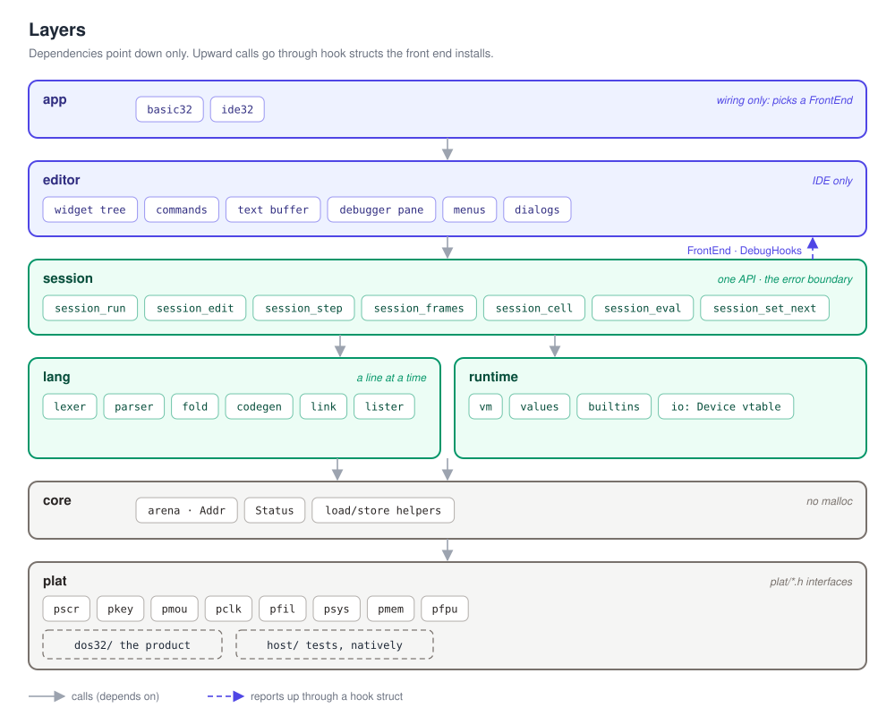
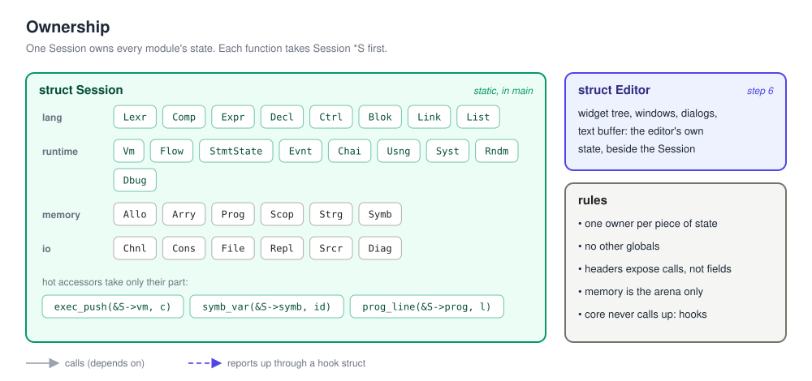
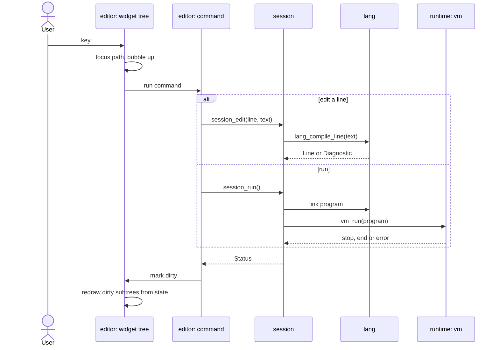
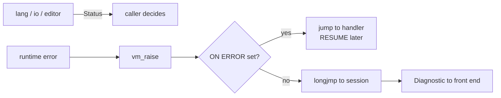
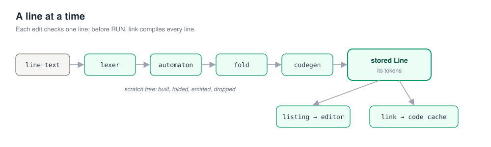
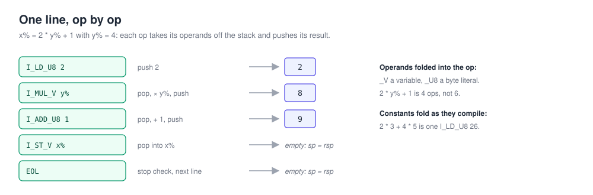
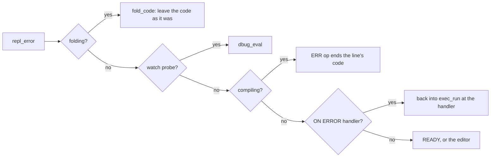
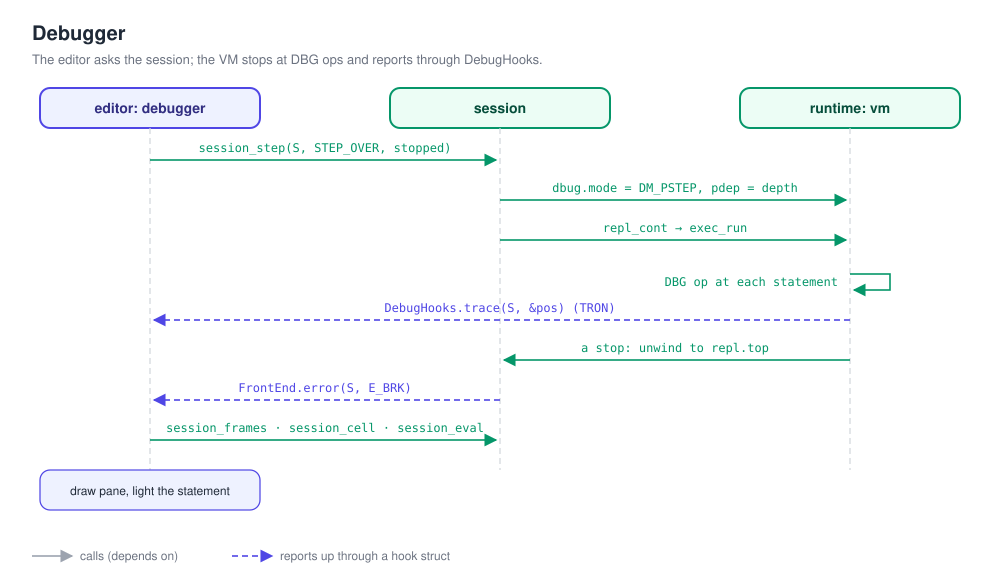
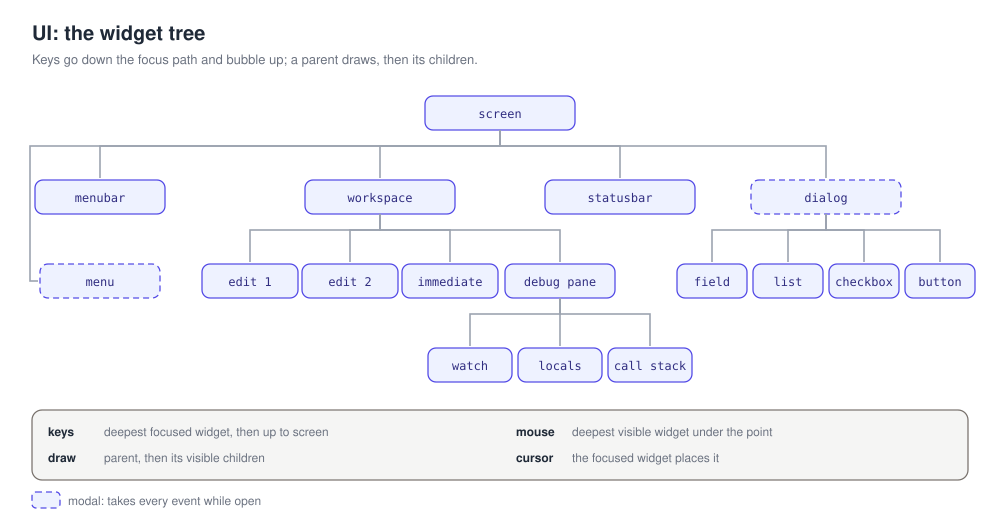
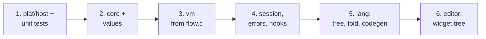

# QuickrBasic C architecture

Target shape for `csrc/`, replacing the asm-mirrored layout.

## Goals

- **Best practices:** clean, clear code.
- **Clear ownership:** every piece of state has exactly one owner.
- **Clear flow:** you can follow any event from a key press to the result.
- **DRY:** each fact lives in one place.
- **SRP:** a module or function does one job.
- **Clean boundaries:** no mixing across them. See [Boundaries](#boundaries).
- **Open/closed:** new features are added as new entries or modules, not as edits to existing switches.
- **Small and simple:** no over-engineering. The rules above apply only as far as they keep the code smaller and clearer.
- **UI:** slightly more general, and hierarchical. Each component is handled by its parent automatically, so a future UI change is local.
- **Line at a time:** each line is still parsed and compiled as it is entered or edited.
- **Debugging:** every debugger feature stays.
- **Readable layout:** `make cstyle` formats every C file: one parameter per line when a signature does not fit, a blank line between a function's steps.
- **Idiomatic C23:**
  - `const` on everything that does not change.
  - Indexed `for` loops.
  - Named load/store helpers for word access, never `memcpy`.
- **Same behaviour:** output, errors, stored lines, bytecode and file records stay byte for byte. The asm and C builds stay side by side and pass the same suites.

## Layers



## Modules

| Module | Owns | Does |
|---|---|---|
| `core/arena` | `Arena` | `Addr`, loads and stores; what PEEK and VARPTR see |
| `lang/lexer` | none | Text to tokens |
| `lang/parser` | `Ast` (scratch) | Tokens to a tree, one line at a time |
| `lang/fold` | none | Constant folding, type conversion |
| `lang/codegen` | none | Tree to bytecode; the only code that knows the byte layout |
| `lang/link` | none | Labels, blocks, procedures across lines |
| `lang/lister` | none | A stored line back to text |
| `runtime/vm` | `Vm` | Dispatch, frames, flow, runtime errors, debug stops |
| `runtime/values` | `Heap` | Numbers, strings, arrays; one `Value` and its conversions |
| `runtime/builtins` | none | Statements and functions (`ops.def` table) |
| `runtime/io` | `Channels` | Channels over a `Device` vtable: console, file, null |
| `session` | `Session` | The API both front ends use |
| `editor/*` | `Editor` | Widget tree, text buffer, commands, debugger pane |

## Boundaries

Each stage does one job and hands the next a finished product. Nothing reaches across.

- **Parsing builds a tree and emits nothing.** Every operand, reference and call is a node, including record fields, elements, `VARPTR` and procedure calls. No bytecode is hidden in a leaf.
- **Name resolution answers what a name is.** It returns a description: a variable, a record field's place, a procedure. It neither parses expressions nor emits.
- **The semantic pass makes the tree valid.** `sema` resolves each name to the facts codegen needs (`const` pointers to the variable, the parameter flag, a call's jump) and raises every type error. A tree that passed it compiles without error.
- **Folding rewrites the tree.** It never emits.
- **Codegen alone writes bytes.** `cg_tree(Code *, const Node *)`: a checked tree in, bytes out. No `Session`, no symbol table, no errors. Statements that need an expression or a reference build its tree and hand it over.
- **A function sits in one stage.** If it both parses and emits, split it.
- **Only top-level functions take the `Session`.** A REPL command, a statement driver or a UI event handler takes it and passes each module just its own state and inputs, e.g. `blok_find(Blok *, ...)`. A function below that level never sees the whole session.
- **A function's name starts with its owner's prefix,** static ones too: `ast_`, `sema_`, `fold_`, `cg_` (codegen), `blok_`. The name says which boundary it sits in.
- **Tables are allocated, not fixed.** Compile-time tables live in arenas and link by pointer. Ids stay only where they are stored, such as a procedure's number in bytecode.

## Ownership



- `app` creates the one `Session` and the one `Editor`. There are no other globals.
- Every module's state is one struct, a field of the `Session`. A function that reads or changes any of it takes `Session *S` first; the editor's take `Editor *`.
- Hot accessors take only the part they touch (`exec_push(&S->vm, c)`), so headers need not see the whole `Session`.
- Headers expose functions and opaque types. No module reads another's fields.
- A program's memory is the BASIC arena only. The C side's scratch, such as a statement's tree, comes from bump arenas (`util/arena.h`) that grow by blocks from the platform and are freed all at once. No malloc in the core.
- The core never calls up into a front end. It reports through `FrontEnd` (`repl.h`) and `DebugHooks` (`vm/debug.h`), which the front end installs.

## Flow



- Commands change state. Drawing reads state. Neither does the other's job.

## Errors

- `lang`, `io` and `editor` return `Status`.


- Runtime errors go through `vm_raise`. The VM handles `ON ERROR`/`RESUME` itself, and otherwise does a `longjmp` to the one boundary, in `session`.

## Line at a time



- `lang_compile_line(text) → Line` stores the line's tokens and bytecode. The editor calls it on every edit, and the REPL on every entered line.
- The tree is scratch: it is built, folded, turned into code and dropped within the call.
- `link` resolves what spans lines (labels, FOR/NEXT, IF blocks, SUB/FUNCTION) over the stored lines. It runs before RUN, or after an edit that changes block structure.
- `lister` turns one stored line back into text for the editor.

## The VM


The VM is a stack machine over byte code. `exec_run` is its one loop: it notes the op's place in `vm.opip` and calls the op's handler. The handler reads its operands at `vm.ip`, moves `vm.ip` past them or to a jump's target, and returns.

**Code.** Each stored line is compiled once into the 64 KB code cache, the first time the run reaches it. Its code starts with a statement map (each statement's body offset to its code offset), then the ops. An op is one byte, then its operands. When the cache is full it is flushed, and lines compile again as they are reached.

**Values.** The data stack holds 8-byte `Cell`s: an INT, a SINGLE's bits, an `Addr` or a DOUBLE. An op pops its operands and pushes its result. At a statement's start `sp` is `rsp`, so the stack is empty.



**Operand forms.** Common right operands are folded into the op, so `2 * y% + 1` is three ops rather than five:

| Suffix | Operand | Example |
|---|---|---|
| none | the stack | `I_ADD` |
| `_V` | a variable's id | `I_MUL_V y%` |
| `_U8`, `_I16`, `_F32` | a literal | `I_ADD_U8 1` |
| `_A1`, `_A` | an array element: one or n subscripts | `I_LD_A1 a%` |

`I` ops work on INTs, `F` on SINGLEs, `D` on DOUBLEs and `S` on strings. `CALL k` runs one of 181 routines (PRINT, INPUT, MID$ ...).

**Control.** GOSUB, a SUB or FUNCTION call, and an event's handler each push a `Frame` on `vm.frames`. A call's frame is on the data stack: its arguments' addresses above `vm.fp`, its locals' cells below, an array's among them. A loop is plain loads, stores, a compare and a jump; its limit and step are hidden variables:

```text
FOR i% = 1 TO 3: total! = total! + i% / 2: NEXT
I_LD_U8 1 | I_ST_V i% | I_LD_U8 3 | I_ST_V lim | I_LD_U8 1 | I_ST_V step | I_LD_V i% | I_CMP_V lim > | I_JT → after NEXT
F_LD_V total! | F_LD_VI i% | F_DIV_U8 2 | F_ADD | F_ST_V total!
I_LD_V i% | I_STEP_V step | I_ST_V i% | I_LD_V i% | I_CMP_V lim > | I_JF → the body | EOL
```

**Jumps.** A GOTO names its line by number and finds it on first use. A jump op keeps its target's code offset once found; a cache flush turns saved places back into offsets within their lines.

**Stops and events.** The ops that end a statement or move between them (EOL, the jumps, GOSUB, RETURN, ON, a procedure's return) check `vm.stop`. The platform sets it for Ctrl+Break and for the timer tick that drives ON TIMER, ON KEY and the other events. In the IDE, a `DBG` op at each statement's start is where steps, breakpoints and trace stop.

**Errors.** A handler raises with `repl_error`. It never returns: it unwinds with `longjmp` to whoever is waiting, in this order:



## Debugger

| Feature | `runtime/vm` | `session` | `editor` |
|---|---|---|---|
| Step, Step Over, Step Out | DBG op, stop modes, depth | `session_step(mode)` | F8, F10, Shift+F8 |
| Breakpoints, Clear All | `LF_BP` on the line | `session_break(line, on)` | F9, row colour |
| Run to cursor | one-time stop line | `session_until(line)` | Ctrl+F7 |
| Set Next Statement | moves `vm->at` in the frame | `session_set_next(line)` | menu |
| Restart | stops at the first statement | `session_restart()` | menu |
| Trace | trace hook per statement | `session_trace(on)` | highlights the statement |
| Continue | resumes from the stop | `session_continue()` | F5 |
| Call stack, Locals | frames | `session_frames()`, `session_locals(frame)` | debug pane |
| Watches, tooltip | evaluates in a frame | `session_eval(expr, frame)` | debug pane, tip |



- The VM reports stops and trace events through a `DebugHooks` struct of function pointers, installed with `session_debug`. It never calls up into the editor.
- Watches compile through `lang` like any other line, then run in the chosen frame.

## UI: the widget tree

Each widget handles its own events, passes on what it doesn't handle, and draws its children.

```c
typedef struct Widget Widget;

typedef struct {
    void (*draw)(Widget *w);                  /* itself; children drawn after it */
    bool (*key)(Widget *w, Key k);            /* true: handled */
    bool (*mouse)(Widget *w, MouseEvent m);   /* true: handled */
    void (*layout)(Widget *w);                /* sets children's rects from its own */
} WidgetOps;                                  /* any op may be null: default behaviour */

struct Widget {
    const WidgetOps *ops;
    Rect rect;
    Widget *parent, *children[MAX_CHILDREN];
    uint8_t nchildren, focus;                 /* focus: index of the focused child */
    bool visible, modal, dirty;
};
```




These four rules live once, in `editor/tree.c`:

- **Keys** go down the focus path to the deepest focused widget. If it doesn't handle a key, the key bubbles up to its parent. Global keys (F-keys, Alt) are handled once, on `screen`.
- **Mouse** events go to the deepest visible widget under the point, then bubble up. A modal widget takes everything while it is open.
- **Drawing:** a parent draws itself, then its visible children. A `dirty` widget redraws only its own subtree.
- **Layout:** a parent sets its children's rects. Resize and split are calls on the parent.

What this makes easy:

- A new dialog is a list of controls. It gets Tab, Esc and hotkeys from the dialog container.
- A new pane is one widget added to `workspace`.

What it deliberately leaves out:

- No allocation: widgets are static instances.
- No layout engine: fixed sizes and splits only.
- No event queue: widgets call commands directly.

## Extension points

New behaviour is a table entry, not a new switch case:

- statements and functions: `ops.def`
- devices: the `Device` vtable
- platform: the `plat/*.h` interfaces
- UI: `WidgetOps`, the key-to-command table, menus, themes

Only devices, the platform and widgets get vtables. Everything else is plain functions.

## One of each

- One `Value`, with one conversion module.
- One error table, holding numbers and messages.
- One key and glyph vocabulary.
- One bytecode encoder and decoder.

## Fixed by compatibility

Programs and tests can see these, so they do not change:

- The arena and `Addr`: PEEK, VARPTR, records in files.
- The bytecode bytes: an error's address is a code offset. Codegen must emit today's bytes.

## Testing

- `make chost` builds the core with `plat/host`: native x86-64 (Rosetta's x87 on Apple silicon), so the 80-bit maths matches DOS32's.
- `make cunit` runs `tests/unit` (`TEST`, `CHECK`) after `boot()`. Each module gets its tests here; the lexer, lister and codegen get golden tests over their output bytes.
- `make chosttest` runs the unit tests, then x86f and qbconf on the host build, in seconds. `HOST_SKIP` in `x86f_test.py` names what the host cannot show as DOS does.
- `make ctest`, the DOSBox suites (x86f, qbconf, the IDE suite), stays the end-to-end gate.

## Migration

Each step lands green on both gates:



Step 5 puts the statements through the tree. A statement is a list of steps, each checked as it is parsed, then resolved, folded and generated when the statement ends. Every action and control statement makes steps; only the statement driver writes code itself (the statement map, DBG, EOL, ERR).
