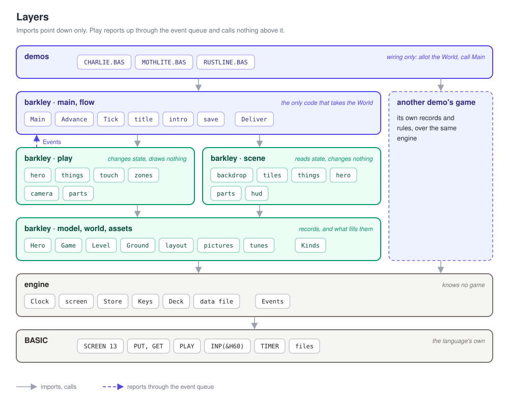
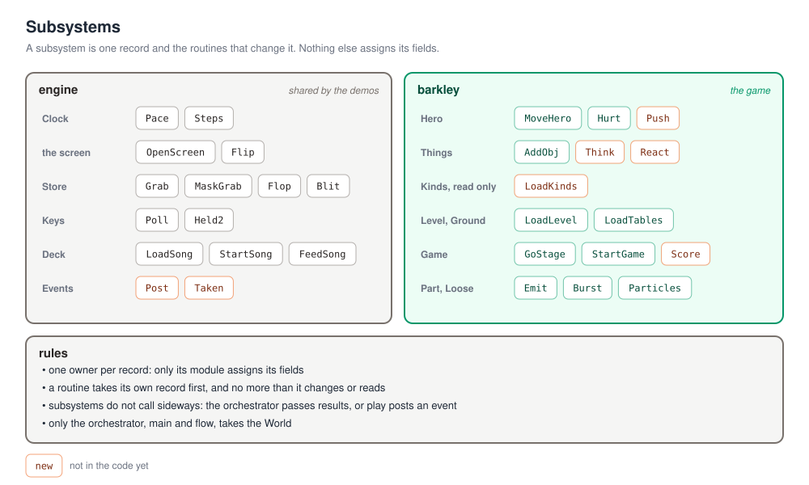
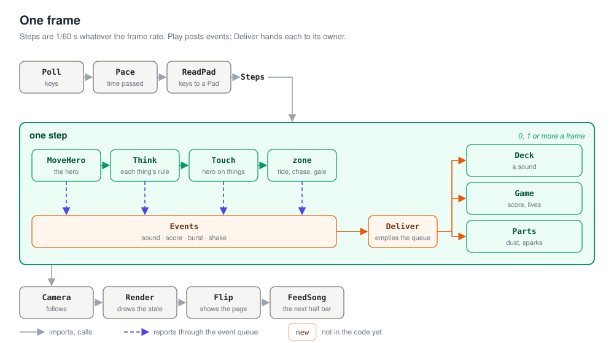
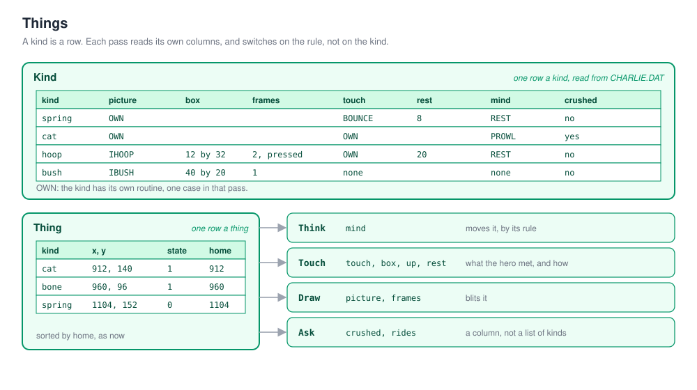

# A 2D engine for the demos

A design, not built yet. CHARLIE BARKLEY's `barkley` package becomes a small engine any demo can
use, and a game over it.

## Goals

- **A subsystem is one record and the routines that change it.** Everything below is built of them.
- **Clear ownership:** only a record's own module assigns its fields.
- **Separation:** play changes state and draws nothing. Drawing reads state and changes nothing.
- **DRY:** a fact about a kind of thing is one column of one row.
- **SRP:** a routine takes the records it changes or reads, and no others.
- **Open/closed:** a new kind of thing is a row. A new rule is one routine and one `case`.
- **Shared:** `engine` knows no game. A subsystem moves into it when a second demo needs it.
- **Small and simple:** a thing stays one fixed record. No scene graph, no script language, no
  component store.

## Layers



- `engine` is `barkley/engine` moved beside the demos. It imports nothing from the game today.
- Imports point down, by name.
- Play calls nothing above it. What it has to report, it posts as an event.

## Subsystems



| Subsystem | Record | Module | Does |
|---|---|---|---|
| Clock | `Clock` | `engine/clock` | Turns the time that passed into steps of 1/60 s |
| Screen | none: the display | `engine/video` | Mode 13 on two pages, and the flip |
| Pictures | `Store` | `engine/video` | Grabs, mirrors and blits pictures |
| Keys | `Keys` | `engine/input` | Held keys from the port, or from `INKEY$`'s repeats |
| Sound | `Deck` | `engine/audio` | Songs from the data file, fed to `PLAY` half a bar at a time |
| Data | the open file | `engine/datafile` | Words and strings from the data file |
| Events | `Events` | `engine/events`, new | What happened this step, in order |
| Hero | `Hero` | `stage/hero` | Moves him. Takes a push or a hurt |
| Things | `Thing` | `stage/things`, new | Runs each thing's rule. Changes a thing that was touched |
| Kinds | `Kind` | `model/kinds`, new | What each kind looks like, does and gives. Read only once loaded |
| Level | `Level`, `Ground` | `world` | The level as laid, and its ground |
| Game | `Game`, `Session` | `flow` | Score, lives, the state of play, the save |
| Effects | `Part`, `Loose` | `stage/fx` | Particles and dropped bones |
| Scene | none | `stage/scene` | Draws all of it |

## Boundaries

- Only a record's own module assigns its fields. Any module may read them.
- A routine takes its own record first, then only what it reads.
- A subsystem does not call another's modifiers. The orchestrator calls each with the other's
  result.
- Play posts an event for what it does not need answered: a sound, a score, a burst of sparks.
- Only the orchestrator, `main` and `flow`, takes the `World`.
- Drawing assigns nothing but the screen.
- BASIC cannot enforce the first rule, so the game's test counts the assignments made outside an
  owner. The count may only fall.

## One frame



- The loop is today's: `Poll`, `Pace`, `ReadPad`, a step for each that `Steps%` counts, then the
  camera, the drawing, the flip and the song.
- A step runs its passes in one fixed order.
- `Deliver` then empties the queue. Each event goes to its owner's modifier, in the order posted.

## Events

```basic
type Event
    what as integer
    at as Vec
    amount as integer
end type

Post events, EVSOUND, hero.at, SSPRING
```

- `Post` appends an event. `Taken%` hands out the next, and is false when none is left.
- The queue is a fixed array in an `Events` record. A full queue drops the event and counts it, and
  the game's test fails on a count above zero.
- Events replace the `Deck`, `Session`, `Part` and `Loose` parameters that play takes only to pass
  on to `Sfx` and `Burst`.

## Things



- A `Kind` row holds what three switches hold now: the picture, box and frames; what a touch does
  and gives; the rule it moves by; the facts asked about it, such as whether it is a foe.
- A pass switches on the rule, not the kind. A cat, a crab and a sweeper share `PROWL`.
- BASIC has no procedure values, so each pass keeps one `select case`. A rule is named nowhere else.
- A kind too odd for the table says `OWN` and keeps its own routine and case.
- A touch is split by owner. `Touch` finds what the hero met and how. `Push` gives the hero the
  bounce, the stop or the hurt. `React` changes the thing. The sound and the score are events.
- `tools/charlieart.py` writes the rows into `CHARLIE.DAT`, beside the pictures they name.

`MeetSpring` shows the split. Today it assigns seven of the hero's fields and one of the spring's,
and plays a sound. It becomes a row: box 16 by 16, `BOUNCE`, 560 up.

## Code rules

**Layout**

- Keywords and built-ins are lower case.
- One statement a line. One `const` a line.
- Code is 70 columns at most, a comment 60.
- A blank line parts a routine's paragraphs: after each guard, between its blocks.
- A `case` body is always on its own line, indented.
- A header that does not fit one line is wrapped as Python's: `(` ends the first line, each
  parameter has its own line one indent in, and `) as type` closes it. Today each wrapped line ends
  in ` _`.

**Names and data**

- Variables and fields are snake_case. A name says what it means and stays short.
- A record is made of smaller records: a position and a velocity are each a record of `x` and `y`.
  `pos` is a reserved word today, so the field is `at`.
- No globals and no `dim shared`. State is records passed as parameters.
- Dynamic arrays live in records. Nothing has a fixed limit.
- A file's number is never assumed: `freefile` gives it and a record keeps it.

**Flow**

- Guards first: `exit` and `continue` instead of nested conditionals, in `for`, `do` and `while`
  too.

**Packages**

- A package is split by what its code does. Deeper means narrower.
- A child never imports its parent. An import names what it uses, never `*`.
- An engine package carries no game's name.

**All of it**

- DRY, SRP, open/closed and separation of concerns, as in the goals.
- Speed and memory count: a frame's loops stay tight, and a zone loads only its own pictures and
  songs.
- A comment is for what the code cannot say. Names and structure carry the rest.
- A gap in the language is reported to the language, not worked around here.
- Every fix gets a regression test that fails first, in the same commit.

```basic
type Vec
    x as single
    y as single
end type

type Hero
    at as Vec
    vel as Vec
    on_ground as integer
end type

' A point moved by a speed for a time.
sub Move ( _
    at as Vec, _
    vel as Vec, _
    dt as single _
)
    at.x = at.x + vel.x * dt
    at.y = at.y + vel.y * dt
end sub
```

## Today

| Measure | Now |
|---|---|
| Kinds of thing | 63 |
| `case` branches that name a kind: draw, touch, think | 60, 36, 16 |
| Draw branches that are one `Blit` | 33 of 60 |
| `Meet` routines, in six zone modules | 34 |
| Comparisons of a thing's kind outside those switches | 60, in 10 files |
| Files that assign a thing's field | 14, in 96 assignments |
| Routines that take the `Deck` | 108 of 402 |
| `Sfx` calls outside `assets` | 60 |
| Routines that take the whole `World` | 19 |
| Game code that `engine` imports | none |
| Other game demos with their own key, clock and sound code | 4 of 4 |
| Lines over 70 columns | 1,267 of 8,595 |
| Comment lines over 60 columns | 674 of 946 |
| Routine headers over 70 columns | 180 |

## Steps

Each step leaves `tools/charlie_test.py` passing and the game playing as before.

1. Apply the code rules to `barkley`, one record's renames a commit.
2. Move `barkley/engine` to `demos/engine`. Imports change and no code does.
3. Add `Events`, sounds first: play posts, `Deliver` calls `Sfx`, and the `Deck` leaves play's
   parameter lists. Then score, bursts and shakes.
4. Add `Kind` rows inside `barkley`. Drawing first, where 33 branches become rows. Then the facts
   asked about kinds. Then touch and rules, a zone at a time.
5. Move a subsystem from `barkley` to `engine` when MOTHLITE or RUSTLINE needs it.

The drawings are made by `python3 tools/diagrams/engine.py docs/img`.
