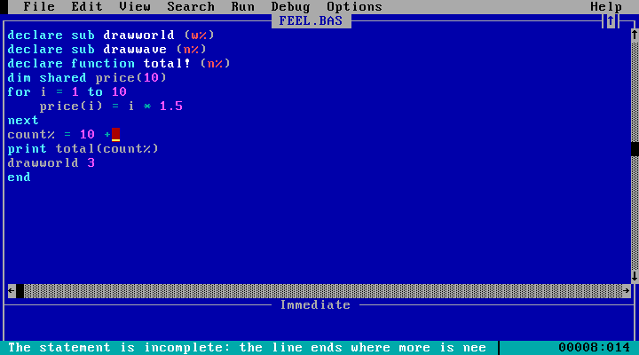
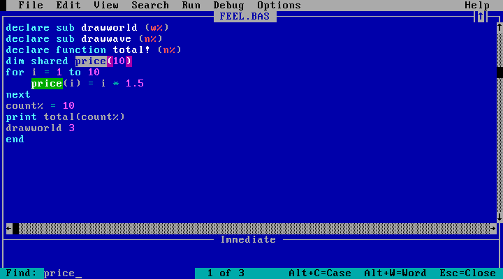
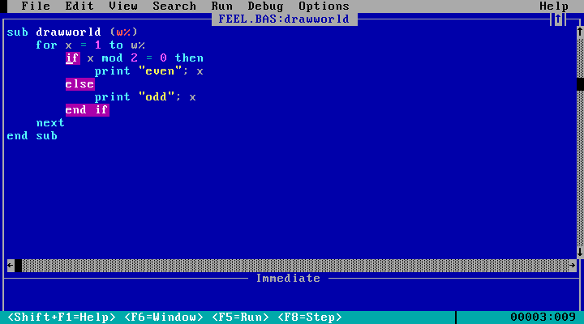
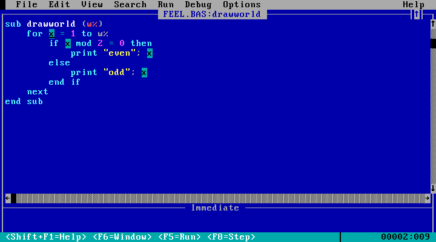
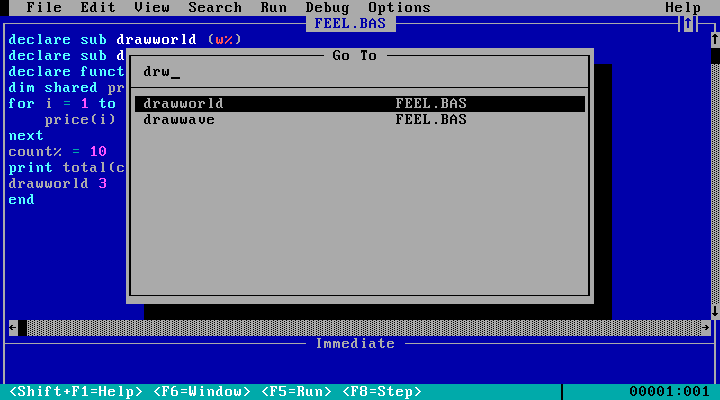
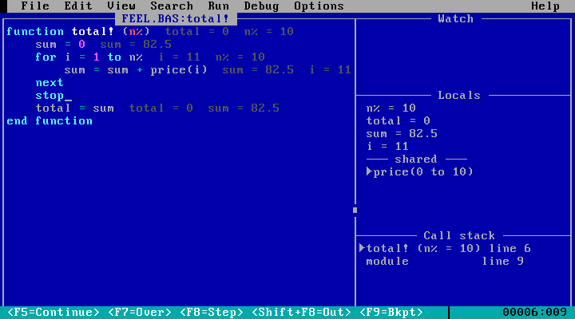

# The editor's feel: design

Ten changes that bring the editor's handling up to a modern one's, keeping QBasic's keys. Each is built on
the module named, drawn with its own theme slot, and tested in `tests/unit/editor_test.c` through keys and
the screen.

## Keys

| Key | Does |
|---|---|
| Ctrl+Z, Alt+Backspace | Undo |
| Ctrl+Shift+Z | Redo |
| Ctrl+F8 | The next line with an error |
| Search, Find | The find bar |
| F3, Shift+F3 | The next match, the one before |
| Alt+Up, Alt+Down | Move the line, or the selected lines |
| Shift+Alt+Up, Shift+Alt+Down | Copy them above, below |
| Ctrl+/ (Ctrl+- too) | Comment the lines out, or back in |
| Ctrl+Backspace, Ctrl+Del | Delete the word before, after |
| Double-click | Select the word |
| Ctrl+] | To the matching bracket or block keyword |
| Ctrl+P | Go to a procedure or file by a few of its letters |
| Alt+Left, Alt+Right | Back to where a jump started, forward again |

Each key is free in QBasic's set and in the WordStar keys. A terminal sends Ctrl+Shift+Z as Ctrl+Z, so
Redo is also in the Edit menu.

## 1. Undo and redo

Every change to the text can be undone, back to when the program was opened.

- Typing on a line undoes a word at a time while the cursor stays on the line. Once it leaves, the line's
  changes are one step.
- A command that changes many lines is one step: a paste of lines, a cut, Change All, a line moved.
- Undo puts the cursor where the change was, in its procedure's view.
- A change after an undo drops what could be redone.
- At most 256 steps or 64 KB of text are kept; the oldest go first. Opening or a new program empties it.

Built on `ui/undo.c`. `text.c` tells it each line it replaces, inserts or deletes, with the old text and
the new; `edit.c` tells it where a step starts and ends. Undo plays a step's changes back in reverse
through `text.c`, then rebuilds the views.

## 2. Errors without the box

A line with a syntax error no longer stops the cursor. It is stored as typed, as now, and lit:

- The error's word is drawn in SL_ERR.
- With the cursor on the line, the status bar shows the message; at its right, the count of lines with
  errors.
- Ctrl+F8 goes to the next one, through every procedure and module.
- A run still stops at the first, as now.

Built on `edit.c` (commit without `dlog_err`) and a new `ui/errors.c` that finds the error lines
(`LF_ASIS`) and their messages (`edit_canon`), cached per record.

## 3. The find bar

Search, Find opens a bar on the status row instead of a box:

- Each key typed moves to the first match from where the search began, at once.
- Every match on screen is drawn in SL_FIND; the count is of the whole program.
- Enter or F3 goes to the next, Shift+Enter or Shift+F3 to the one before. The search goes through every
  procedure and module, then wraps.
- Alt+C and Alt+W switch Match Case and Whole Word.
- Esc closes the bar and leaves the match selected. A key that is not the bar's closes it and acts.
- Change keeps its box.

Built on a new `ui/findbar.c`; the matching is uimain.c's `match`, moved to `ui/search.c` for both.

## 4. Lines: move, copy, comment

- Alt+Up and Alt+Down swap the line, or the lines the selection covers, with the one above or below.
  The selection moves with them.
- Shift+Alt+Up and Shift+Alt+Down copy them above or below.
- Ctrl+/ puts `' ` at each line's indent, or takes it away when every line has one.
- Each is one undo step. None moves a line into or out of a SUB.

Built on a new `ui/lines.c`, over `edit.c`.

## 5. Words

- Ctrl+Backspace and Ctrl+Del delete to the word's start or end, as Ctrl+Left and Ctrl+Right move.
- A double-click selects the word under the mouse; a triple-click, the line.

Built on `edit.c` and `mouse.c`.

## 6. Closing pairs

In insert mode, typing `"` or `(` puts in the closing one too, the cursor between them, when what follows
is a space, the line's end or a closing bracket. Typing the closing one over itself steps over it.
Backspace between an empty pair deletes both. Inside a string or a comment nothing is added.

Built on a new `ui/closers.c`; the string and comment test is the highlighter's.

## 7. Matches lit

With the cursor on a bracket, it and its partner are drawn in SL_MATCH. On a block's keyword, every
keyword of that block is:

The blocks are IF/ELSEIF/ELSE/END IF (not a one-line IF), FOR/NEXT, DO/LOOP, WHILE/WEND,
SELECT/CASE/END SELECT, SUB/END SUB, FUNCTION/END FUNCTION and TYPE/END TYPE. Ctrl+] goes to the next
keyword of the block, or the partner bracket.

Built on a new `ui/pairs.c`: brackets over the highlighter's slots, blocks over `ui/indent.c`'s keywords.

## 8. The name at the cursor

With the cursor on a name, every other use of it on screen is drawn in SL_OCC. A use is the same name, case
aside, its suffix the same or none, where the highlighter colours a name: not in a string or comment.

Built on a new `ui/uses.c`, over the highlighter's slots.

## 9. Go to, back and forward

Ctrl+P opens a box that lists every procedure and file. Typing narrows it to the entries whose letters
contain the typed ones in order:

Enter shows the one chosen. Go To, Go to Definition, F2's list, Find, F3 and Ctrl+F8 remember where the
cursor was: Alt+Left goes back, Alt+Right forward again. 32 places are kept.

Built on a new `ui/jumps.c` for the places and `ui/goto.c` for the box.

## 10. Values beside the code

At a stop, each line of the stopped procedure that shows on screen gets the values of the variables it
names, dim after its end:

Numbers and strings only; a record or array shows nothing. Values cut at the window's edge. They go when
the run goes on.

Built on `ui/debuginline.c`: the names are where the highlighter colours one, the values Locals' rows
(`ui/debuglocals.c`, over `vm/inspect.h`), so they follow the selected frame and its spelling.

## Quickr

The editor takes both dialects. A file is Quickr's when its first line is `' OPTION DIALECT QUICKR`,
QBasic's otherwise. The main file's is the program's; its modules may be of either
([Interop](language-design.md#interop)).

- That first line is shown and saved but cannot be typed over, cut or joined: a file's dialect is fixed.
- File, New asks the dialect; a Quickr program starts with that line. The status bar names the
  program's dialect before its bar, when the errors' count leaves room.
- A Quickr line is stored as typed, its text the record's body (`LF_TEXT`), and saved as typed.
- The modules a Quickr program imports open as a QBasic program's do, each its own view after the
  main's. A Quickr file is one view: its functions stay where they are written, and F2 lists them
  under their file.
- A line entered is lexed and parsed at once in its file, as the lines around it make it: a field's
  line in a type, a line inside an open bracket. A block not closed yet is no error. A line with an
  error is lit as a QBasic one is (`LF_ASIS`).
- F5 checks the whole program first (types, borrows): the first error puts the cursor at its line and
  column, its message in a box.
- Run, Break, the steps and breakpoints work by line. A generic function's instance runs on copies
  of its lines (`LF_INC`), each mapped back to its line by file and source line (`prog_origin`); a
  breakpoint toggled while stopped is set on the copies too (`prog_marks`). A run-time error puts
  the cursor at its line, an assert's message Quickr's.
- Locals, Call stack and Watch spell names as typed, without suffixes; a function's frame shows its
  name. A record in cells opens to its fields as a box does; Quickr's hidden variables are not
  shown. A name a block declares again over an outer one's shows as typed.
- A watch is a Quickr expression, printed as `print` would: its names the stopped statement's, a
  block's over an outer one's, `v.length()` a call. A value set in Locals is a Quickr assignment.
- The immediate window runs a Quickr line: a call or an assignment, a value alone printed. Stopped,
  its names are the stopped statement's; else the modules', after their last line, the program
  linked first. It runs on the checked program the link keeps (`qr.c`'s `QrKeep`), each statement's
  names in sight kept by the check; a line needing a list, a record or a generic's new instance of
  its own can't run there.
- A run goes through the modules in import order, each module's last line on to the next one's first
  (`qr/qlink.c`), so the store keeps the order the files were read in.

- Highlighting lexes a Quickr line with Quickr's lexer (`qr_colour`): its keywords, a function's
  name and parameters, types after `as`, strings and f-strings, the comment past the last token.
- Completion offers Quickr's keywords and the names in the file; after `m.` an imported module's
  public names, a QBasic module's SUBs, FUNCTIONs and TYPEs; after `m.E.` an enum's values; after
  `v.` the fields and methods of `v`'s record type, as declared (`v as T`), a QBasic TYPE's fields
  too, or a list's, a dict's or a string's methods, as the checker has them (`qsem_methods`)
  (`qr_suggest`). A Quickr module's names come from its parsed lines, a QBasic module's from
  QBasic's own symbol table (`bind_each_export`).

- F1 in a Quickr program looks up `quickr WORD` (`help/qr/`): a keyword, a module, a module's
  `m.name`, else the module before the dot; no topic opens the Quickr index. QBasic's topics are
  never shown for a Quickr word.

Built on the dialect's hooks (`io/dialect.h`; Quickr's table in `qr/qr.c`) and `ui/text.c`. The
editor names no dialect: a text dialect's lines go through its table.

### Both dialects in one program

A QBasic main may import Quickr modules, a Quickr main QBasic ones. The editor opens, runs and
debugs either as it does a program of one dialect.

- Each line is its file's dialect's (`dial_file`, `text_dialect_at`): stored, checked, coloured
  and looked up in F1 by it. Lines typed in a Quickr file of a QBasic program are kept as typed.
- F5 runs the main's dialect's way: a QBasic main relinks, its Quickr modules checked as it
  declares them; a Quickr main links, its QBasic modules declared first. A compile error in either
  file puts the cursor at its line, its message its dialect's.
- A Quickr program's store holds the Quickr files' lines first, then each QBasic module's after
  its `LF_TOP`, each file numbered as its module (`repl_guests_stored`). A Quickr module imported
  later goes before the QBasic ones'.
- A QBasic program's Quickr module's own imports are found again at each relink
  (`Dialect.guest_find`), as its QBasic lines' are.
- Steps, breakpoints and Ctrl+F7 work by line in either file. Locals, Call stack, Watch and the tip
  spell a name as its dialect does: Quickr's as typed, QBasic's with its suffix. A watch, a value
  set in Locals and the immediate window run in the stopped frame's dialect, a QBasic one's names
  its module's.
- Completion goes by the line's file's dialect. After `m.` a QBasic line offers module `m`'s
  exports as `IMPORT` binds them (`bind_each_export`), a Quickr module's those QBasic sees.
- A Quickr program's modules are those its imports reach, a QBasic module's own `IMPORT`s too
  (`modu_unreached`, as a QBasic program's): one no longer imported is dropped at the next link,
  before its lines are read again.
- A line stored in a QBasic program's module of another dialect declares the program again
  (`Dialect.redeclare`): its exports reach completion at once. One with an error exports nothing
  till it checks; the run says the error.

## Theme slots

Five slots, set in every theme: SL_ERR, SL_FIND, SL_MATCH, SL_OCC, SL_HINT.

## Later

- Find References and Rename across modules: they need every line's names resolved, as Go to
  Definition resolves one. Next, after this.
- Parameter help while typing a call to the program's own SUBs and FUNCTIONs.
- A stop at an untrapped run-time error, with Locals still there.
- Recovery files and reloading a file changed on disk: they need file times from the platforms.
- Recent files, which need a settings file.
