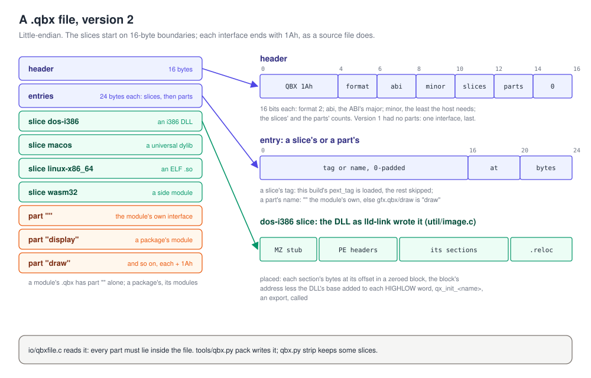
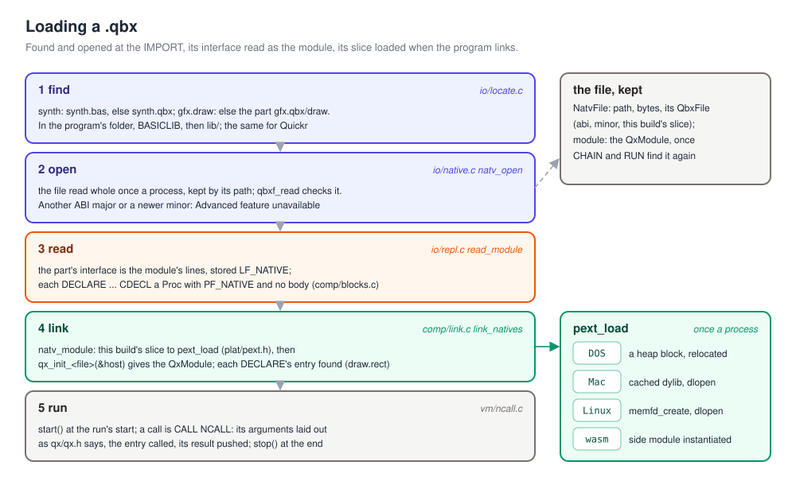
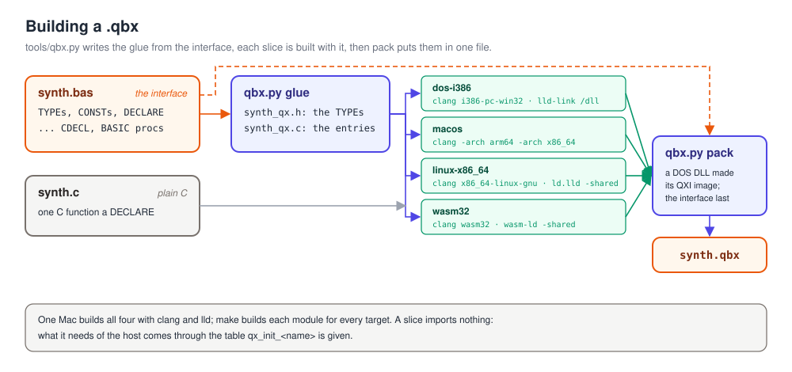

# Native extensions: design

A native extension is a module whose procedures are machine code. The program writes `IMPORT synth`
and it works on DOS, the Mac, Linux and the browser, in the IDE and in `basic32`. The extension is
one file, `synth.qbx`: a BASIC interface and one slice of code for each platform. The synthesizer is
the first one; it leaves the language.

Status: the extensions themselves (steps 1 to 3) are built, and checked on the Mac, Linux, DOS, node and
the browser. The synthesizer's move (steps 4 and 5) is a design. `tools/extproto/run.sh` is the
prototype that settled the loaders.

## What the program sees

```basic
import synth
synth.instrument 1, kick
synth.note 1, 36, 96, 12
print synth.beat()
```

- `synth.qbx` is found as `synth.bas` is: the program's folder, each folder of `BASICLIB`, then
  `lib/` beside the interpreter. The synthesizer ships in that `lib/`.
- No flag, no path and no step for a platform: the same file is copied everywhere.
- Its names follow the rules of any module's: `synth.note`, or `FROM synth IMPORT note`. A Quickr
  file imports it as it imports a QBasic module.
- A platform the file has no code for still opens, checks and completes the program. A run stops
  at the IMPORT line with a new error: Native code not built for this machine.

## Python, the reference

| Python | QuickrBasic |
|---|---|
| `foo.cpython-312-darwin.so`, a wheel for each platform, pip picks one | `foo.qbx`, every platform's slice in it; nothing to pick |
| `PyInit_foo` returns a `PyModuleDef` | `qx_init_foo` returns a `QxModule` |
| the C API, the limited API and `abi3` | one API, all of it limited: the table `qx_init_<name>` is given |
| `.pyi` stubs for the editor | the interface: BASIC source in the file |
| `sys.path` | `locate.c`'s roots |
| the inittab: modules built into the interpreter | the same table, for tests and a platform with no loader |
| `import readline` changes `input()` | `IMPORT synth` gives `PLAY` its synthesizer (below) |

## On disk



A `.qbx` is little-endian: the header, the entries, the slices, then the parts. `tools/qbx.py
pack` writes it and `io/qbxfile.c` reads it.

| Part | Holds |
|---|---|
| Header | 16 bytes: `QBX` and 1Ah, the file format's version (2), the ABI's major and the minor it needs, the slices' and the parts' counts |
| Entries | 24 bytes each, the slices' then the parts': a tag or a name, an offset and a size |
| Slices | each platform's code, each from a 16-byte boundary |
| Parts | interfaces, BASIC source: TYPEs, CONSTs, native DECLAREs, procedures in BASIC; each followed by 1Ah, so the loader reads one as a source file from its offset. The module's own is named "" |
| Help (later) | pages for F1, in the help's Markdown |

The header:

| Offset | Bytes | Field |
|---|---|---|
| 0 | 4 | `QBX` and 1Ah |
| 4 | 2 | the file format's version, 2 |
| 6 | 2 | the ABI's major |
| 8 | 2 | the ABI's minor it needs at least |
| 10 | 2 | the slices' count |
| 12 | 2 | the parts' count |
| 14 | 2 | 0 |

An entry, the slices' from offset 16, the parts' after them:

| Offset | Bytes | Field |
|---|---|---|
| 0 | 16 | a slice's tag (`dos-i386`, `macos`, `linux-x86_64`, `wasm32`) or a part's name, 0-padded |
| 16 | 4 | its offset |
| 20 | 4 | its bytes, a part's without its 1Ah |

The reader checks the magic and the format's version, and that every entry lies inside the file: a
`.qbx` is read from wherever the program is. It takes the slice tagged `pext_tag`, this build's,
and finds a part by its name, case aside. Version 1 is still read: no parts' count, the interface's
offset and bytes at 12 and 16, its slices' entries from 20, the interface last.

A package's `.qbx` holds its modules' interfaces over the same slices, as
[gfx's architecture](../stdlib/gfx/docs/architecture.md#the-package) has it. Its modules are
named as a folder's: `gfx.draw` is the part `draw` of `gfx.qbx`, whose path `locate.c` gives as
`gfx.qbx/draw`, as Python's zipimport names a module in a zip. Its DECLAREs bind to the entries
named `draw.NAME`. A module's own `.qbx` has the part "" alone.

The DOS slice is the `lld-link` DLL itself. Being a standard PE file, debuggers and profilers name
its code from its link map. `pack` checks it as `util/image.c` loads it: an i386 DLL that imports
nothing, exports `qx_init_<name>`, and relocates only 32-bit words.

| Slice | Holds | Loaded by |
|---|---|---|
| `dos-i386` | an i386 DLL, as `lld-link` writes it | our loader: a heap block, the sections copied, the relocations added, the entry called |
| `macos` | a universal dylib, arm64 and x86-64 | written once to `~/Library/Caches/QuickrBasic/<hash>.dylib`, then `dlopen` |
| `linux-x86_64` | an ELF shared object | `memfd_create`, then `dlopen("/proc/self/fd/n")`: no file written |
| `wasm32` | a side module (`wasm-ld -shared`) | the worker's JS: instantiated into the IDE's own memory and table |

**One file, not one per platform.** There is no installer to pick a slice, so the file carries all
of them. Today's `synth.c` is 30 KB of i386 code, 37 KB of arm64 and 41 KB of wasm. `tools/qbx.py
strip` keeps only some slices, for the DOS release.

**The native loaders where there are some.** `dlopen` gives debuggers and crash reports the
extension's symbols. On arm64 macOS only signed pages run, and the linker signs a dylib. DOS/32A has
no loader, but its code and data share one zero-based flat segment, so a relocated image in the
heap runs as it is. The loader checks that CS's base is DS's before it calls one.

**A slice imports nothing.** Everything an extension needs from the host comes through the table
`qx_init_<name>` is given. So a Linux slice needs no glibc version, the DOS loader resolves no symbols, and
the wasm side module imports only the memory, the table, the stack and its two bases. The Mac's
linker refuses a dylib without libSystem, so it is linked, and no symbol of it is used.

## The ABI: `src/qx/qx.h`

The contract between the host and an extension's glue. The author writes plain C functions and
`tools/qbx.py` writes the glue ([below](#writing-one-plain-c)). The header is its own, with
`stdint.h` alone.

```c
typedef struct QxCall QxCall;
typedef void QX_CALL QxFn(QxCall *c);

typedef struct { const char *ptr; uint32_t len; } QxStr;
typedef struct { void *data; uint32_t count, elem; int32_t lbound; } QxArray;

typedef union {      /* one argument, as the DECLARE has it */
    int32_t i;        /* INTEGER, LONG, SHORT and BYTE by value */
    float f;
    double d;
    QxStr s;          /* a string, read-only */
    void *ref;        /* by reference: the variable; a record */
    QxArray *a;       /* an array, name() */
} QxArg;

struct QxCall {
    const QxHost *host;
    const QxArg *arg;
    QxArg result;     /* a FUNCTION's; a string's through host->result_str */
    uint8_t error;    /* not 0: raised at the calling line once the entry returns */
};

typedef struct { const char *name, *kinds; QxFn *fn; } QxEntry;  /* kinds: a letter an argument */
typedef struct { const char *name; uint32_t bytes; } QxType;     /* a TYPE the entries read */

typedef struct {
    uint32_t size, abi;
    const QxEntry *entries; uint32_t nentries;
    const QxType *types; uint32_t ntypes;
    void (QX_CALL *start)(void);  /* a run starts: RUN's defaults */
    void (QX_CALL *stop)(void);   /* it ends: END, an error, Break, CHAIN, an edit */
} QxModule;

typedef struct QxHost {
    uint32_t size, abi;           /* grows at its end only */
    void *(QX_CALL *alloc)(uint32_t bytes);
    void (QX_CALL *free)(void *p);
    void (QX_CALL *result_str)(QxCall *c, const char *p, uint32_t len);
    bool (QX_CALL *stopped)(void);              /* Ctrl+Break: a long entry looks */
    bool (QX_CALL *audio_open)(QxAudio *a);     /* below */
    void (QX_CALL *play_device)(const QxPlay *p);
    /* ... */
} QxHost;

const QxModule *QX_CALL qx_init_synth(const QxHost *host);
```

- **One shape for every entry**, `void f(QxCall *)`: no thunk for each signature in the host. The
  host lays the arguments out as the DECLARE has them, Python's `METH_FASTCALL`.
- **`kinds`** has a letter an argument: `XFn`'s I, W, U, F, D and S (`comp/builtins.h`), R an array,
  T a record, & before a number by reference.
- **Errors are returned, not thrown.** An entry sets `c->error` and returns; the host raises it. No
  `longjmp` runs through the extension's frames, which matters on DOS and for wasm's
  exception-based `longjmp`.
- **Pointers last for the call.** The collector may move a string or an array after it. An entry
  keeps a copy of what it needs.
- **`QX_CALL` is cdecl on i386.** The core is built `-mregparm=3`; the ABI does not follow the
  core's flags.
- **The extension's memory is the host's** (`host->alloc`): the C heap (`pmem_resize`), on wasm
  in the shared memory.
- **The host's services are generic**: audio, pages to draw in, a GPU that plays lists
  (`qx/qxlist.h`), with shaders or, from minor 5, a fixed pipeline (from minor 6 at 8 bits too).
  It knows no extension; one shipped with QuickrBasic lives in `stdlib/` and brings
  the rest itself, gfx its shaders.

## Binding: QB 4.5's DECLARE

QB 4.5 called C and asm routines through `DECLARE SUB name CDECL ALIAS "name" (...)`. The compiler
parses that form today and ignores CDECL and ALIAS (`comp/control.c`). In a native module's
interface it names an entry:

```basic
' synth.qbx's interface
type event
    tick as long
    length as long
    sound as short
    pitch as byte
    loud as byte
end type
declare sub note cdecl (byval n%, byval pitch%, byval length%, byval loud%)
declare sub music cdecl (events() as event, byval loop_from%)
declare sub stop_song cdecl alias "music_stop" ()
declare function beat! cdecl ()
```

A CDECL DECLARE in a native module is native: ALIAS names its entry, else its own name does.
Elsewhere CDECL changes nothing.

1. **Load.** The interface is read as a module's lines, as a `.bas` is (`io/repl.c`). The IDE
   reads it when an IMPORT is typed, `basic32` when the program loads. The editor shows its lines
   and does not change them.
2. **Link** (`link_start`). The slice is loaded the first time (`pext_load`) and `qx_init_<name>`
   called. Each native DECLARE finds its entry by name: none, Subprogram not defined. The entry's
   `kinds` must match the declaration's parameters, and each `QxType` the TYPE of its name in
   bytes: else Parameter type mismatch at the DECLARE. The procedure keeps the entry.
3. **Run.** The arguments are pushed as a PCALL's, then the procedure's number and
   `CALL K_NCALL` (`vm/ncall.c`): the op table is full. It lays the arguments out from the
   procedure's entry and calls. Nothing is looked up by name while the program runs.

## Writing one: plain C

```c
#include "synth_qx.h" /* tools/qbx.py glue synth OUTDIR synth.bas */

void synth_init(void) { qx_host->audio_open(&audio); }
void synth_start(void) { ... }
void synth_stop(void) { ... }

void synth_note(int32_t n, int32_t pitch, int32_t length, int32_t loud) { ... }
void synth_music(const QxArray *events, int32_t loop_from) { const synth_event *e = events->data; ... }
float synth_beat(void) { ... }
```

`tools/qbx.py glue` reads the interface and writes two files:

- `NAME_qx.h`: each numeric CONST as C's; each TYPE as a packed struct, its size asserted as BASIC
  lays it out; each native DECLARE as a C prototype, named with the module (and a package's part:
  gfx's `draw.sprite` is `gfx_draw_sprite`), or as its ALIAS. A function that does not match its
  DECLARE is a compile error. A DECLARE's `_` lines are one.
- `NAME_qx.c`: a wrapper for each, which lays out the `QxCall`'s arguments for the function; the
  entry table with its kinds; `qx_init_NAME`, which calls `NAME_init`.

| BASIC | C |
|---|---|
| `integer`, `long`, `%`, `&` | `int32_t` |
| `short` | `int16_t` |
| `byte` | `uint8_t` |
| `single`, `!` | `float` |
| `double`, `#` | `double` |
| `string`, `$` | `QxStr`, read-only; a FUNCTION's is copied in |
| a number by reference | its pointer |
| a record | `NAME_type *` |
| an array, `x()` | `const QxArray *` |

`qx_fail(code)` sets the running call's error. pybind11, nanobind and Cython do the same for
Python.

The VM does no translation of its own. A foreign call at run time would need assembly for i386,
x86-64 and arm64. It could not reach wasm at all, whose indirect calls must name the exact
signature. Generated glue leaves every calling convention to the C compiler.

## Versioning

- The ABI has a major and a minor, in the file's header and in the handshake. A host loads only
  its own major: else Native module needs another QuickrBasic, at the IMPORT line.
- A minor adds to the end of `QxHost`. An extension built for minor n loads on every host from n
  on, and checks `host->size` for anything newer. `QxModule.size` does the same the other way.
- Frozen for a major: `QxCall`, `QxArg`, `QxStr` and `QxArray`, cdecl, the kinds' letters, and the
  wasm features the side module is built with.
- The file format has its own version: a reader of version 1 reads every version 1 file.
- This is Python's `abi3` with no other API beside it: one build runs on every later host of its
  major, so a file needs no tag for each host version.

## Lifetime

- A slice is loaded once in a process and never unloaded, as in Python. CHAIN and a new program
  keep it.
- `start` runs at each run's start, `stop` at each end. The synthesizer sets its voices back in
  `start` and is quiet after `stop`.
- A rebuilt `.qbx` loads again when its bytes change: the hash names its cached file.

## Audio, and code that runs elsewhere

The host keeps the devices: the Sound Blaster on DOS, SDL's callback on the Mac, the page's
AudioWorklet, and the PC speaker. An extension asks for a stream:

```c
typedef struct {
    uint32_t rate;      /* asked; the host writes what it gives */
    bool stereo;
    void (QX_CALL *render)(int16_t *out, int32_t frames);
} QxAudio;
```

`render` runs elsewhere: in the Sound Blaster's interrupt on DOS, in SDL's thread on the Mac, and in
the AudioWorklet's thread in the browser. So it touches only the extension's own memory and calls
nothing in the host. On DOS it uses no x87, as `synth.c` already does not. The program's side
changes what `render` reads between `audio_lock` and `audio_unlock`, which hold the device off:
interrupts off on DOS, SDL's stream lock on the Mac.

`plat/paud.h` is the host's side: each device (`sb.c`, `plat/sdl/audio.c`) mixes every stream open
where it plays, the built-in synthesizer one of them. The first stream starts the device, the last
stops it, and the process's end closes them all.

- **DOS.** The card's rate, 15873 Hz, mono. The image's pages are not locked (DPMI 0600h): DOS/32A
  pages nothing by default, and the synthesizer's state is not locked either.
- **The browser.** 48000 Hz, stereo; the page's AudioContext runs at that rate. The worklet
  instantiates the same slice against the same shared memory, with its own table at the same table
  base and its own stack. Its pointers mean there what they mean in the worker. The host's slots in
  its table are empty, so a call into the host traps, and the worklet drops that stream. The lock
  is a word in shared memory, which the worklet holds while `render` runs.
- **No device** (DOS without a Sound Blaster, Linux): `audio_open` returns false. The synthesizer
  then plays voice 1 on the speaker, as today.

## Finding one

- `locate.c` looks for `name.bas`, then `name.qbx`, then a package's part, under each root. A `.bas`
  at the same root wins.
- A FROM package's folder may hold `.qbx` modules as it holds `.bas` ones.
- `lib/` beside the interpreter: `LIB\SYNTH.QBX` beside `IDE32.EXE`; in the app,
  `Contents/Resources/lib` (locate's root moves there in a bundle); `C:\LIB\` in the page's file
  system (`psys_self` is `C:\BASIC.EXE`), filled as the demos are; `lib/` beside `basic` on Linux.
- The IDE and `basic32` share the loader. There is no other compiled form: `basic32` runs the
  program.

## Loading, step by step



`io/qbxfile.c` and `io/native.c` are shared by every platform and both dialects.

1. `locate` finds the module (see [Finding one](#finding-one)).
2. `natv_open` reads the file whole, once a process, and keeps it by its path. It checks the header
   and the ABI: another major, or a minor newer than the host's, is Advanced feature unavailable at
   the IMPORT.
3. `read_module` (`io/repl.c`) reads the module's part, its interface, as the module's lines,
   stored `LF_NATIVE`. Each `DECLARE ... CDECL` is a `Proc` with `PF_NATIVE` and no body.
4. When the program links, `link_natives` asks `natv_module` for the module. It hands this build's
   slice to `pext_load` (`plat/pext.h`), once a file, and calls `qx_init_<file's name>` with the
   host's table. The `QxModule` it gives lists the entries; each DECLARE's is found, `draw.rect` in
   a package's part `draw`, and its kinds checked.
5. A run calls each module's `start`, then `stop` at its end. A call is `CALL NCALL`
   (`vm/ncall.c`).

Each platform's `pext_load`:

**DOS** (`plat/dos32/pext.c`, `util/image.c`). The slice is the DLL. The loader:

1. reads its headers and finds the export `qx_init_<name>`;
2. takes a block of its size in memory from `pmem_resize`, aligned to 16;
3. checks that CS's base is DS's and its limit past the block;
4. zeroes the block and copies each section's stored bytes to its offset;
5. adds the block's address less the DLL's base to the 32-bit word at each HIGHLOW relocation, and
   calls the entry, cdecl.

**Mac** (`plat/host/pext.c`):

1. names a file by the slice's hash, `~/Library/Caches/QuickrBasic/<hash>.dylib`;
2. writes it if it is not there: a temporary file, then a rename;
3. `dlopen`, then `dlsym("qx_init_<name>")`.

**Linux:** the same, but the slice is written to `memfd_create` and loaded with
`dlopen("/proc/self/fd/n")`. No file is written.

**Browser and node** (`plat/wasm/pext.c`, `web/wasm.mjs`). The module is linked `--export-table
--growable-table`. The C side calls the `ext_load` import, which runs synchronously on its thread:

1. `new WebAssembly.Module(bytes)`;
2. reads `dylink.0`: the memory and table the module needs;
3. takes zeroed memory from the host's heap (`pext_alloc`) and grows the host's table;
4. instantiates it with the shared memory, the table, `__stack_pointer` and the two bases;
5. runs `__wasm_apply_data_relocs` and `__wasm_call_ctors`, puts `qx_init_<name>` in the table and
   returns its index, the function pointer.

When the extension opens audio (`plat/wasm/paud.c`), the `audio_open` import sends the module, its
bases, `render`'s index, an out block, a stack and the lock word to the device's thread: through
the page to the AudioWorklet (`synth.mjs`), or in node to `tools/wasm/device.mjs` (`QB_AUDIO`).
That thread instantiates the same module, without relocations or constructors (`wasm.mjs`'s
`stream`), and calls `render` each quantum.

**Unit tests** link an extension in and call its `qx_init_NAME`, as gfx's do (`stdlib/gfx/tests`): its
tests need no loader.

## Building one



`tools/qbx.py glue` writes the glue, each slice is built with it, and `tools/qbx.py pack` puts the
interfaces and the slices in a `.qbx`. `pack` checks a DOS DLL. The flags, as the
prototype used them:

| Slice | Compile | Link |
|---|---|---|
| `dos-i386` | `clang --target=i386-pc-win32 -march=i386 -ffreestanding`; jwasm `-coff` for asm. The glue defines `_fltused` | `lld-link /dll /noentry /nodefaultlib` |
| `macos` | `clang -arch arm64 -arch x86_64 -mmacosx-version-min=13.0 -fvisibility=hidden` | `-dynamiclib` |
| `linux-x86_64` | `clang --target=x86_64-linux-gnu -fPIC -fvisibility=hidden` | `ld.lld -shared -nostdlib` |
| `wasm32` | `clang --target=wasm32 -fPIC -matomics -mbulk-memory` | `wasm-ld -shared --experimental-pic --shared-memory --features=` the host's |

One Mac builds all four with clang and lld. The repo's `make` builds `lib/synth.qbx` for every
target and ships it.

## The synthesizer, moved

| Piece | Today | After |
|---|---|---|
| `plat/synth/synth.c`: oscillators, filter, room | linked into every build | the extension's slices |
| DOS's inner loop (`synthrun.asm`) and its tables | `plat/dos32` | the DOS slice |
| the synthesizer's PLAY commands and voice queues (`play.c`, `music.c`) | the runtime | the extension: one clock in `render`, exact to the sample |
| the timed events (`instrument`, `music`, `note`, `beat`) | planned as keywords | the interface's DECLAREs. No new keyword, so a QBasic program that names a variable `note` still runs |
| the speaker's square wave on the Mac and the page (`synth_tone`) | `synth.c` | the host: QBasic's PLAY needs it with nothing imported |
| Sound Blaster, SDL audio, the worklet | tied to `synth.c` | the host's stream, for any extension |
| `synth.wasm`, `worklet.c`, its loader in `synth.mjs` | the page | gone: the worklet runs the slice |

**PLAY.** The language keeps QBasic's PLAY: one string, the speaker, MF and MB, PLAY(n), ON PLAY.
Its synthesizer becomes a device an extension installs (`host->play_device`: strings in, notes
waiting out, reset). `IMPORT synth` installs it. A `PLAY` with a second string or a synthesizer's
command and no device is Advanced feature unavailable, QB's error 73. MOTHLITE, CHARLIE, the demos
and the tutorial's examples gain an `IMPORT synth` line.

**Steps,** a PR each, with its tests:

1. `qx.h`, the file's reader, `pext` for the host, `K_NCALL`, DECLARE's binding. A small test
   extension called from BASIC (`tests/host/native.sh`). Done.
2. `pext` for wasm and DOS. The wasm one tested in node (`make wasm-test`); the DOS one built, its
   image's reader tested on the host. Done.
3. The audio stream; the Sound Blaster, SDL and the worklet moved onto it. Done: checked on
   DOSBox-X, the Mac and in a browser; node's stand-in device tested (`make wasm-test`).
4. The synthesizer moved into `ext/synth/`, built as `lib/synth.qbx`; PLAY's device; the timed
   events land there.
5. `plat/synth` out of the core's builds.

## The prototype

`tools/extproto/run.sh` builds one extension for each slice. `ext.c` is plain C functions, glued to
`ext.bas` by `tools/qbx.py`. It has data with pointers, a call back into the host and a `render`.
`drive.c`, the VM's stand-in, checks each entry's kinds and each TYPE's size, then calls each entry
as `K_NCALL` does: values, a record, a number by reference, a string in and out, an error.

- **Mac:** a universal dylib loads with `dlopen`; every call is as expected on both halves (x86-64
  under Rosetta). It imports no symbol. Apple's linker refuses one without libSystem, so it is linked.
- **wasm:** the side module loads synchronously into the host's shared memory and growable table.
  Every call is as expected, by pointer both ways. A second
  thread instantiates the same bytes against the same memory and runs `render`, which reads what
  the first thread wrote. `wasm-ld` needs the features named when nothing in the module uses
  atomics.
- **DOS:** an i386 DLL built `-mregparm=3` has no imports and only HIGHLOW relocations. Not run:
  native only.
- **Linux:** a shared object with no needed library. Not run: no Linux here.
- Not checked: dlopen of a file from the cache on a fresh Mac.

## Open questions

1. PLAY: the device an import installs (as above), or `PLAY a$, b$` moves into the module as a
   procedure, leaving the statement for the speaker alone?
2. A synthesizer's PLAY string with nothing imported: error 73 (as above), or the core imports
   `synth` itself? The second keeps every program working and ties the language to the name.
3. One file for every platform (as above), or one for each, smaller but the right one to be
   copied?
4. Which folders may load native code: every root (Python's rule), or only `lib/` beside the
   interpreter unless the user allows the program's folder? The browser's sandbox holds either way.
5. The interface in the editor read-only (as above), or hidden, with F2 listing its procedures?
