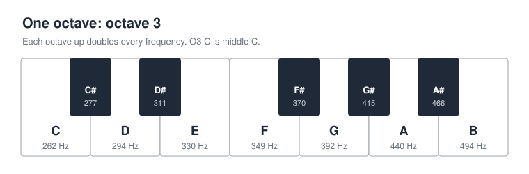
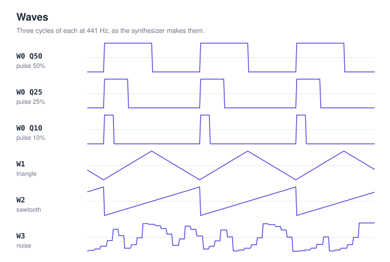
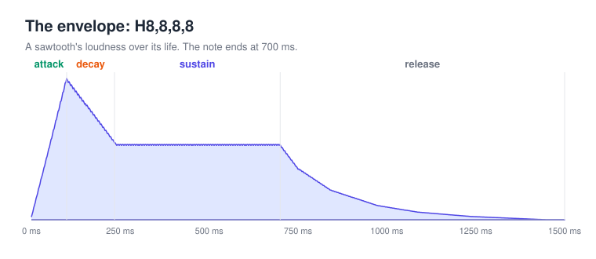
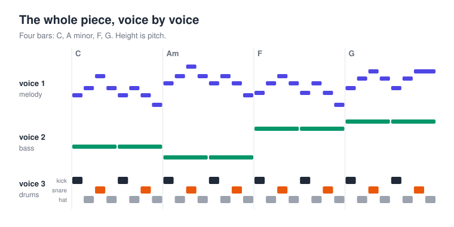

# PLAY: music and sound effects

From zero to a multi-voice piece and game effects. Every example runs: paste it into the IDE, press
Shift+F5. [sound.md](sound.md) is the short reference.

## 1. Notes

A note is a pitch: `C D E F G A B`. A sharp (`#`) is one step up, a flat (`-`) one step down. Twelve
steps make an octave; the next octave up doubles the frequency.



```basic
PLAY "O3 C D E F G A B > C"
```

`O` sets the octave (0 to 6, default 4); `>` and `<` step up and down. `N` plays a note by number:
`N37` is middle C.

```basic
PLAY "O3 C C# D D# E" + "N37 N39 N41"
```

## 2. Time

`L` sets the length: 1 whole, 2 half, 4 quarter, up to 64. A number after a note sets its own. A dot
adds half again. `P` is a rest. `T` is the tempo, in quarter notes a minute (32 to 255, default 120).


```basic
PLAY "T100 O3 C4 D8 E4. P8 G2"
```

`MN` plays 7/8 of each note, `ML` all of it (smooth), `MS` 3/4 (short). Under `ML` a voice's note
repeated at the same pitch is held, not struck again: `ML L2 C L16 C` is one C nine sixteenths long.

```basic
PLAY "T140 O4 ML C D E F G2 MS C D E F G2 MN"
```

## 3. Strings, variables, background

`X` plays another string; `=` takes a number from a variable. Both use `VARPTR$`.

```basic
riff$ = "O3 L16 C E G E"
speed% = 180
PLAY "T=" + VARPTR$(speed%) + "X" + VARPTR$(riff$) + "X" + VARPTR$(riff$)
```

`MB` plays in the background while the program runs on; `PLAY(0)` counts notes waiting; a
foreground rest waits for them.

```basic
PLAY "MB T150 O3 L8 C E G > C"
PRINT "notes waiting:"; PLAY(0)
PLAY "MF P64"
PRINT "done"
```

## 4. Waves

`W` picks the wave. Pulse is the PC speaker's sound; `Q` sets how much of it is high. Triangle is
soft, sawtooth bright, noise a hiss.



```basic
PLAY "T120 O3 L4 W0 C E G P4 W1 C E G P4 W2 C E G P4 W3 C E G"
PLAY "W0 L8 Q50 C C Q25 C C Q10 C C Q5 C C"
```

## 5. Envelope

`H attack, decay, sustain, release` shapes each note's loudness. Attack rises, decay falls to the
sustain level, which holds until the note ends; release fades it out. Each is 0 to 15: attack 2 ms
to 8 s, decay and release 6 ms to 24 s, sustain silent to full.



An organ, a pluck, a swell, a bell:

```basic
PLAY "T90 O3 L2 W2 H0,0,15,0 C H0,6,0,4 C H10,0,15,8 C W1 H0,9,0,9 > C"
```

## 6. Filter and volume

`Y mode, cutoff, resonance` filters the voice: 1 low-pass (darker), 2 band-pass, 3 high-pass
(thinner), 0 off. Resonance (0 to 15) makes it whistle at the cutoff. `V` is volume, 0 to 15.


```basic
PLAY "T120 O2 L4 W2 Y1,3000 C Y1,1200 C Y1,500 C Y1,200 C"
PLAY "Y1,800,0 C Y1,800,8 C Y1,800,15 C Y0 V15 C V7 C V3 C"
```

## 7. Several voices

`PLAY a$, b$, ...` plays up to 32 voices, a string each. Each keeps its own tempo, octave, length
and sound, so set them in every string. `MF`/`MB` apply to all. A string left out leaves its voice
alone: `PLAY , , fx$` plays voice 3 only.

Six voices, a C major chord over two octaves:

```basic
PLAY "L1 W1 V5 O3 C", "L1 W1 V5 O3 E", "L1 W1 V5 O3 G", "L1 W1 V5 O4 C", "L1 W1 V5 O4 E", "L1 W1 V5 O4 G"
```

Three voices hold a chord each bar:

```basic
PLAY "T130 L1 W0 Q30 H4,0,12,6 V7 O3 E E F G", "T130 L1 W0 Q30 H4,0,12,6 V7 O3 G A A B", "T130 L1 W0 Q30 H4,0,12,6 V7 O4 C C C D"
```

One voice can play a chord as a fast arpeggio:

```basic
PLAY "T130 L16 W0 Q20 H0,2,8,1 V6 O3 C E G > C < G E C E G > C < G E C E G E"
```

Noise makes drums: low and filtered is a kick, middle a snare, high and thin a hi-hat.

```basic
kick$ = "H0,4,0,3 Y1,300,4 O1 C"
snare$ = "H0,4,0,4 Y0 O4 C"
hat$ = "H0,1,0,1 Y3,6000 O6 C"
bar$ = kick$ + hat$ + snare$ + hat$ + kick$ + hat$ + snare$ + hat$
PLAY "T130 L8 W3 V8 " + bar$ + bar$
```

**The whole piece.** Melody, bass and drums over C, A minor, F and G. Each string adds up to four
bars, so the voices stay together.



```basic
melody$ = "T130 O4 L8 W2 H0,5,9,3 V9 E G > C < G E G E C A > C E C < A > C < A E F A > C < A F A F C G B > D < B G B > D4"
bass$ = "T130 O2 L2 W1 H0,8,10,4 V11 C C O1 A A O2 F F G G"
kick$ = "H0,4,0,3 Y1,300,4 O1 C"
snare$ = "H0,4,0,4 Y0 O4 C"
hat$ = "H0,1,0,1 Y3,6000 O6 C"
bar$ = kick$ + hat$ + snare$ + hat$ + kick$ + hat$ + snare$ + hat$
drums$ = "T130 L8 W3 V7 " + bar$ + bar$ + bar$ + bar$
PLAY melody$, bass$, drums$
```

## 8. Sound effects

An effect is a few fast notes with a sharp envelope. A slide is a run of notes. The clock ticks 18.2
times a second, so each note lasts at least 55 ms: at `T255`, use `L16` or longer.


**Jump:** a thin pulse sliding up.

```basic
PLAY "T255 L16 W0 Q25 H0,3,0,1 V10 O3 C E G > C E"
```

**Coin:** two bright notes, the second ringing.

```basic
PLAY "T255 W0 Q50 H0,6,0,6 V10 O5 L16 B > E4"
```

**Laser:** a sawtooth falling fast.

```basic
PLAY "T255 L16 W2 H0,3,0,1 V10 N76 N70 N64 N58 N52 N46"
```

**Explosion:** low noise, low-passed, a long fade.

```basic
PLAY "T255 W3 H0,10,0,10 V15 Y1,900,6 O1 C4 P4"
```

**Hit:** a short burst of noise.

```basic
PLAY "T255 W3 H0,3,0,2 V12 O4 C16 P8"
```

**Power-up:** a triangle climbing two octaves.

```basic
PLAY "T255 L16 W1 H0,2,12,2 V11 O3 C E G > C E G > C E G"
```

**Game over:** slow and falling.

```basic
PLAY "T90 W0 Q30 H2,6,8,8 V10 O3 L8 G F# F E2"
```

**Effects over music.** Play the music on voices 1 and 2 in the background; keep voice 3 for
effects. Leaving the music's strings out leaves the music playing.

```basic
tune$ = "T130 O4 L8 W2 H0,5,9,3 V8 E G > C < G E G E C"
bass$ = "T130 O2 L2 W1 V10 C C"
jump$ = "T255 L16 W0 Q25 H0,3,0,1 V10 O3 C E G > C E"
coin$ = "T255 W0 Q50 H0,6,0,6 V10 O5 L16 B > E4"
PLAY "MB" + tune$, bass$
FOR i = 1 TO 3
    PLAY , , jump$
    PLAY , , coin$
NEXT
PLAY "MF P64"
```

## 9. On DOS

With a Sound Blaster (DSP 2.00 or later, named by `BLASTER`, as DOSBox sets it), DOS plays every voice
as the Mac and the browser do, at 15873 samples a second. Without one, the PC speaker plays voice 1
only, as a plain square wave; `V W Q H Y` do nothing there. Put the melody in the first string.
`SOUND` and QBasic's own `PLAY` always use the speaker:

```basic
FOR f = 2000 TO 400 STEP -200
    SOUND f, 1
NEXT
```
