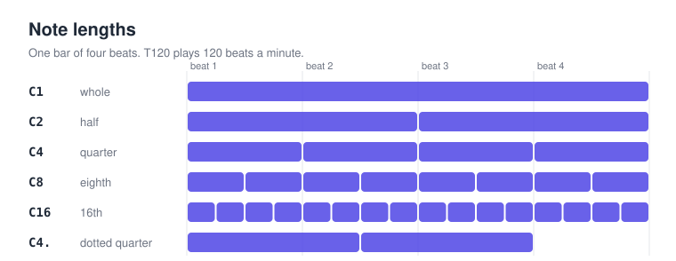
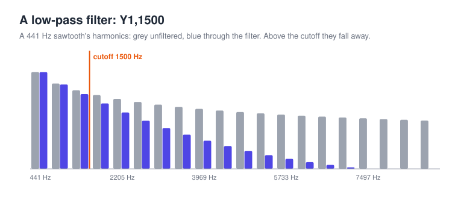
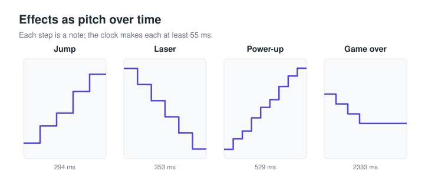

# PLAY: music and sound effects

From zero to a full arrangement and game effects. Every example runs: paste it into the IDE, press
Shift+F5. [sound.md](sound.md) is the short reference.

## 1. Notes

A note is a pitch: `C D E F G A B`. A sharp (`#`) is one step up, a flat (`-`) one step down. Twelve
steps make an octave; the next octave up doubles the frequency.


```basic
PLAY "O3 C D E F G A B > C"
```

`O` sets the octave (0 to 6, default 4); `>` and `<` step up and down. `N` plays a note by number:
`N37` is middle C.

```basic
PLAY "O3 C C# D D# E" + "N37 N39 N41"
```

## 2. Time

`L` sets the length: 1 whole, 2 half, 4 quarter, up to 64. A number after a note sets its own. A dot
adds half again. `P` is a rest. `T` is the tempo, in quarter notes a minute (32 to 255, default 120).



```basic
PLAY "T100 O3 C4 D8 E4. P8 G2"
```

`MN` plays 7/8 of each note, `ML` all of it (smooth), `MS` 3/4 (short). Under `ML` a voice's note
repeated at the same pitch is held, not struck again: `ML L2 C L16 C` is one C nine sixteenths long.

```basic
PLAY "T140 O4 ML C D E F G2 MS C D E F G2 MN"
```

## 3. Strings, variables, background

`X` plays another string; `=` takes a number from a variable. Both use `VARPTR$`.

```basic
riff$ = "O3 L16 C E G E"
speed% = 180
PLAY "T=" + VARPTR$(speed%) + "X" + VARPTR$(riff$) + "X" + VARPTR$(riff$)
```

`MB` plays in the background while the program runs on; `PLAY(0)` counts notes waiting; a
foreground rest waits for them.

```basic
PLAY "MB T150 O3 L8 C E G > C"
PRINT "notes waiting:"; PLAY(0)
PLAY "MF P64"
PRINT "done"
```

## 4. Waves

`W` picks the wave. Pulse is the PC speaker's sound; `Q` sets how much of it is high. Triangle is
soft, sawtooth bright, noise a hiss. The fifth wave, FM, has its own chapter (8).


```basic
PLAY "T120 O3 L4 W0 C E G P4 W1 C E G P4 W2 C E G P4 W3 C E G"
PLAY "W0 L8 Q50 C C Q25 C C Q10 C C Q5 C C"
```

## 5. Envelope

`H attack, decay, sustain, release` shapes each note's loudness. Attack rises, decay falls to the
sustain level, which holds until the note ends; release fades it out. Each is 0 to 15: attack 2 ms
to 8 s, decay and release 6 ms to 24 s, sustain silent to full.


An organ, a pluck, a swell, a bell:

```basic
PLAY "T90 O3 L2 W2 H0,0,15,0 C H0,6,0,4 C H10,0,15,8 C W1 H0,9,0,9 > C"
```

## 6. Filter and volume

`Y mode, cutoff, resonance` filters the voice: 1 low-pass (darker), 2 band-pass, 3 high-pass
(thinner), 0 off. Resonance (0 to 15) makes it whistle at the cutoff. `V` is volume, 0 to 15.



```basic
PLAY "T120 O2 L4 W2 Y1,3000 C Y1,1200 C Y1,500 C Y1,200 C"
PLAY "Y1,800,0 C Y1,800,8 C Y1,800,15 C Y0 V15 C V7 C V3 C"
```

## 7. Several voices

`PLAY a$, b$, ...` plays up to 32 voices, a string each. Each keeps its own tempo, octave, length
and sound, so set them in every string. `MF`/`MB` apply to all. A string left out leaves its voice
alone: `PLAY , , fx$` plays voice 3 only.

Six of them, a C major chord over two octaves:

```basic
PLAY "L1 W1 V5 O3 C", "L1 W1 V5 O3 E", "L1 W1 V5 O3 G", "L1 W1 V5 O4 C", "L1 W1 V5 O4 E", "L1 W1 V5 O4 G"
```

Three voices hold a chord each bar:

```basic
PLAY "T130 L1 W0 Q30 H4,0,12,6 V7 O3 E E F G", "T130 L1 W0 Q30 H4,0,12,6 V7 O3 G A A B", "T130 L1 W0 Q30 H4,0,12,6 V7 O4 C C C D"
```

One voice can play a chord as a fast arpeggio:

```basic
PLAY "T130 L16 W0 Q20 H0,2,8,1 V6 O3 C E G > C < G E C E G > C < G E C E G E"
```

Noise makes drums: low and filtered is a kick, middle a snare, high and thin a hi-hat.

```basic
kick$ = "H0,4,0,3 Y1,300,4 O1 C"
snare$ = "H0,4,0,4 Y0 O4 C"
hat$ = "H0,1,0,1 Y3,6000 O6 C"
bar$ = kick$ + hat$ + snare$ + hat$ + kick$ + hat$ + snare$ + hat$
PLAY "T130 L8 W3 V8 " + bar$ + bar$
```

**The whole piece.** Melody, bass and drums over C, A minor, F and G. Each string adds up to four
bars, so the voices stay together.


```basic
melody$ = "T130 O4 L8 W2 H0,5,9,3 V9 E G > C < G E G E C A > C E C < A > C < A E F A > C < A F A F C G B > D < B G B > D4"
bass$ = "T130 O2 L2 W1 H0,8,10,4 V11 C C O1 A A O2 F F G G"
kick$ = "H0,4,0,3 Y1,300,4 O1 C"
snare$ = "H0,4,0,4 Y0 O4 C"
hat$ = "H0,1,0,1 Y3,6000 O6 C"
bar$ = kick$ + hat$ + snare$ + hat$ + kick$ + hat$ + snare$ + hat$
drums$ = "T130 L8 W3 V7 " + bar$ + bar$ + bar$ + bar$
PLAY melody$, bass$, drums$
```

## 8. FM

`W4` is a sine, the purest tone there is, bent by a second sine: the modulator. Bending adds
harmonics, so the modulator is the tone control. `Z ratio, depth, fall, level, feedback` sets it.

**Depth** is how bright. 0 is the plain sine; each step up adds harmonics.

```basic
PLAY "T120 O3 L2 W4 H0,0,15,2 Z1,0 C Z1,4 C Z1,8 C Z1,12 C"
```

**Ratio** is the modulator's pitch, in multiples of the note's. 1 is full, like a sawtooth; 2 hollow,
like a square; high odd ones ring like metal.

```basic
PLAY "T120 O3 L2 W4 H0,0,15,2 Z1,8 C Z2,8 C Z3,8 C Z7,8 C"
```

**Fall and level** move the brightness inside each note. The bend starts at full depth, falls at
the speed `fall` (the envelope's decay scale) and holds at `level` (15 is no fall, 0 falls to a plain
sine). A real plucked or blown note starts bright and mellows: this is what makes FM sound alive.

```basic
PLAY "T100 O2 L2 W4 H0,6,6,3 Z1,12,0,15 C Z1,12,4,4 C Z1,12,7,0 C"
```

**Feedback** makes the modulator bend itself: 1 to 4 add a brassy edge, 6 and 7 turn to noise.

```basic
PLAY "T100 O3 L2 W4 H0,0,15,2 Z1,6,0,15,0 C Z1,6,0,15,3 C Z1,6,0,15,5 C"
```

Four instruments, each a `Z` and an `H`:

```basic
bass$ = "W4 Z1,12,4,4 H0,5,5,1"
brass$ = "W4 Z1,9,3,11,4 H0,4,12,1"
organ$ = "W4 Z1,4,3,13,4 H0,4,11,1"
bell$ = "W4 Z7,6,7,0 H0,9,0,9"
PLAY "T120 L4 V11 " + bass$ + "O2 C C G G" + brass$ + "O4 C E G2" + organ$ + "O4 C E G2" + bell$ + "O5 C E G2"
```

## 9. Moving the pitch

`U` is vibrato: the pitch wavers six times a second, but only once a note has lasted a fifth of a
second. Fast notes stay clean; held notes sing. 3 to 6 is a player's vibrato, 9 and up an organ's.

```basic
PLAY "T100 O4 W4 Z1,9,3,11,4 H0,4,12,2 L8 C D E F U0 G1 U6 G1 U12 G1"
```

`K time, over, under` slides each note into its pitch. With the time alone it slides from the last
note: a synth lead's portamento.

```basic
PLAY "T120 O3 L4 W2 Y1,2000,4 H0,4,12,2 K0 C G > C < G K8 C G > C < G"
```

`under` starts each note that many semitones flat: a scoop, as a singer or a bent guitar string.

```basic
PLAY "T100 O4 L4 W0 Q30 H1,4,10,2 K0 E G A2 K8,0,2 E G A2"
```

`over` starts it sharp, at 1 + over/4 times its pitch. Fast and far, on a plain sine, it is a drum:
the kick of the next chapters. The glide stays set: put `K0` before a sound that
should not slide.

```basic
PLAY "T120 L4 W4 Z1,0 H0,4,3,3 K1,8 V12 O1 C C C C"
```

## 10. Width and space

`I` doubles the voice with a copy a few cents sharp. The two drift in and out of step, as two
players do: 2 thickens, 6 to 8 is a string section, 15 a honky-tonk.

```basic
PLAY "T90 O3 L1 W2 Y1,2400,4 H3,5,11,4 I0 C I4 C I8 C"
```

`S` places the voice: 1 the far left, 8 the middle, 15 the far right. Keep the bass and the kick in
the middle; spread chords and doubled parts to the sides.

```basic
PLAY "T120 O4 L4 W0 Q30 H0,4,9,2 S1 C S4 E S8 G S12 > C S15 E"
```

`R` sends part of the voice to a room: one reverb for all, its tail about a second. A little (2 to
5) puts a lead in a space; drums and bass stay dry (0) or they blur.

```basic
PLAY "T100 O4 L4 W4 Z1,9,3,11,4 H0,4,12,1 R0 C E G P4 R6 C E G P4 R12 C E G P2"
```

On DOS a Sound Blaster is mono and has no unison; the notes are the same.

## 11. A drum kit

Each drum is a sound and one note. Kicks and toms are a sine falling fast (`W4 Z1,0` with `K`);
snares and hats are noise (`W3`), the hat high-passed.

| Drum | Sound | Note |
|---|---|---|
| kick | `W4 Z1,0 H0,4,3,3 Y0 K1,8` | `O1 C` |
| snare | `W3 H0,5,0,1 Y0 K0` | `O6 C` |
| closed hat | `W3 H0,3,0,1 Y3,2500 K0` | `O6 B` |
| open hat | `W3 H0,7,0,4 Y3,2500 K0` | `O6 B` |
| tom | `W4 Z1,0 H0,5,0,3 Y0 K5,6` | `O2 C` to `O2 B`, low to high |

Every drum sets everything the others change (`W`, `H`, `Y`, `K`), so they can follow each other on
one voice in any order. A helper builds a bar from a pattern, a letter a sixteenth:

```basic
DECLARE FUNCTION Beat$ (pattern$)
PLAY "T120 L16 V12 " + Beat$("K.H.S.H.K.KHS.HO") + Beat$("K.H.S.H.KKH.S.TT")

FUNCTION Beat$ (pattern$)
    b$ = ""
    FOR i = 1 TO LEN(pattern$)
        SELECT CASE MID$(pattern$, i, 1)
        CASE "K": b$ = b$ + "W4Z1,0H0,4,3,3Y0K1,8O1C"
        CASE "S": b$ = b$ + "W3H0,5,0,1Y0K0O6C"
        CASE "H": b$ = b$ + "W3H0,3,0,1Y3,2500K0O6B"
        CASE "O": b$ = b$ + "W3H0,7,0,4Y3,2500K0O6B"
        CASE "T": b$ = b$ + "W4Z1,0H0,5,0,3Y0K5,6O2G"
        CASE ELSE: b$ = b$ + "P16"
        END SELECT
    NEXT
    Beat$ = b$
END FUNCTION
```

One voice plays one drum at a time. For a hat under a kick, give the kick and snare one voice and
the hats another.

## 12. Writing a song

**Count in bars.** A bar of 4/4 is one whole note: sixteen sixteenths. Write every voice's bar so
its lengths add up to exactly that (`L8` × 8, `L4` × 4, `C2 P4 E8 E8`). Voices whose bars are all
the same length never drift apart. A note held over the bar line is two notes under `ML`: `ML G2`
ending one bar and `G4` starting the next sound as one.

**Give each voice a job.** A full band fits in eight to ten voices:

| Voice | Job | Sound | `V` | `S` |
|---|---|---|---|---|
| 1 | lead melody | `W4 Z1,9,3,11,4 H0,4,12,1 U8 R4` | 11 | 8 |
| 2 | second melody or harmony | `W0 Q30 H1,4,10,1 U5 I4` | 8 | 11 |
| 3–5 | a chord, a note each | `W4 Z1,4,3,13,4 H0,4,11,1 U9` | 7 | 4, 8, 12 |
| 6 | bass | `W4 Z1,12,4,4 H0,5,5,1` | 11 | 8 |
| 7 | kick, snare, toms | chapter 11 | 12 | 8 |
| 8 | hats | chapter 11 | 9 | 10 |
| 9 | sound effects | whatever plays | 12 | 8 |

Voice 1 is also what `PLAY(0)` counts and what a PC speaker plays, so it gets the melody. Leave a
voice free for effects: `PLAY , , , , , , , , fx$` plays voice 9 over the rest.

**A chord is a voice a note.** Three voices holding C, E and G are a chord; a fourth an octave under
is a bass. Stabs (short chords with rests between) leave room for the melody.

**Keep the sound out of the notes.** Put each instrument in a string of its own and add it in front
of the notes, with the tempo. Then a bar's string is only notes, and changing an instrument is one
edit.

**Feed it a bar at a time.** A voice's queue holds 18 notes, so a whole song does not fit in one
`PLAY`. In the foreground that does not matter: `PLAY` waits. In a game, play in the background
(`MB`) and queue the next bar when the last is nearly done. `PLAY(0)` counts voice 1's notes still
waiting (rests count), so give voice 1 something in every bar.

**Mix.** All the voices are added, and a sum over full scale is turned down, which ducks
everything under the loudest. If the music pumps when the kick hits, lower the volumes: chords 6 to
8 a voice, lead and bass 10 to 12, drums 10 to 14.

**The whole song.** Four bars of C, A minor, F, G, looped twice: a brass lead, three organ voices
stabbing the chords, an FM bass and drums, fed a bar at a time while the program counts.

```basic
DECLARE FUNCTION Beat$ (pattern$)
CONST BARS = 4
DIM lead$(BARS - 1), upper$(BARS - 1), middle$(BARS - 1), lower$(BARS - 1), bass$(BARS - 1), drum$(BARS - 1)
tempo$ = "T126 "
brass$ = tempo$ + "W4 Z1,9,3,11,4 H0,4,12,1 U8 R4 S8 V11 ML L8 "
organ$ = tempo$ + "W4 Z1,4,3,13,4 H0,4,11,1 U9 R2 V7 MS L8 "
deep$ = tempo$ + "W4 Z1,12,4,4 H0,5,5,1 V11 MN L8 "
kit$ = tempo$ + "L16 V12 "

' the melody, a bar a string: eight eighths each
lead$(0) = "O4 E G > C4 < G E G4"
lead$(1) = "O4 E A > C4 < A E A4"
lead$(2) = "O4 F A > C4 < A F A4"
lead$(3) = "O4 G B > D4 < B G > D4"
' the chords, stabbed on the off beats: C, A minor, F, G
upper$(0) = "O4 P8 G P8 G P8 G P8 G": middle$(0) = "O4 P8 E P8 E P8 E P8 E": lower$(0) = "O4 P8 C P8 C P8 C P8 C"
upper$(1) = "O4 P8 A P8 A P8 A P8 A": middle$(1) = "O4 P8 E P8 E P8 E P8 E": lower$(1) = "O4 P8 C P8 C P8 C P8 C"
upper$(2) = "O4 P8 A P8 A P8 A P8 A": middle$(2) = "O4 P8 F P8 F P8 F P8 F": lower$(2) = "O4 P8 C P8 C P8 C P8 C"
upper$(3) = "O4 P8 B P8 B P8 B P8 B": middle$(3) = "O4 P8 G P8 G P8 G P8 G": lower$(3) = "O4 P8 D P8 D P8 D P8 D"
bass$(0) = "O2 C C > C < C C C > C < C"
bass$(1) = "O1 A A > A < A A A > A < A"
bass$(2) = "O1 F F > F < F F F > F < F"
bass$(3) = "O1 G G > G < G G G B > D"
FOR b = 0 TO 2: drum$(b) = Beat$("K.H.S.H.K.KHS.H."): NEXT
drum$(3) = Beat$("K.H.S.H.K.KHSSTT")

bar = 0
DO WHILE bar < BARS * 2
    IF PLAY(0) < 3 THEN
        b = bar MOD BARS
        PLAY "MB" + brass$ + lead$(b), organ$ + "S4" + upper$(b), organ$ + "S8" + middle$(b), organ$ + "S12" + lower$(b), deep$ + bass$(b), kit$ + drum$(b)
        bar = bar + 1
    END IF
    LOCATE 1, 1: PRINT "bar"; bar; "waiting"; PLAY(0)
LOOP
PLAY "MF P1"

FUNCTION Beat$ (pattern$)
    b$ = ""
    FOR i = 1 TO LEN(pattern$)
        SELECT CASE MID$(pattern$, i, 1)
        CASE "K": b$ = b$ + "W4Z1,0H0,4,3,3Y0K1,8O1C"
        CASE "S": b$ = b$ + "W3H0,5,0,1Y0K0O6C"
        CASE "H": b$ = b$ + "W3H0,3,0,1Y3,2500K0O6B"
        CASE "T": b$ = b$ + "W4Z1,0H0,5,0,3Y0K5,6O2G"
        CASE ELSE: b$ = b$ + "P16"
        END SELECT
    NEXT
    Beat$ = b$
END FUNCTION
```

From here: change a bar's notes, add a second four bars, drop the drums out for a bar before they
come back, raise the lead an octave the second time round. `src/plat/wasm/web/demos/barkley/engine/audio.bas`
plays two songs this way, with fades between them.

## 13. Sound effects

An effect is a few fast notes with a sharp envelope. A slide is a run of notes. A synthesizer note
is timed to 3.4 ms, so `T255 L64` (15 ms a note) is a smooth slide; `K` slides inside one note.



**Jump:** a thin pulse sliding up.

```basic
PLAY "T255 L16 W0 Q25 H0,3,0,1 V10 O3 C E G > C E"
```

**Coin:** two bright notes, the second ringing.

```basic
PLAY "T255 W0 Q50 H0,6,0,6 V10 O5 L16 B > E4"
```

**Laser:** a sawtooth falling fast.

```basic
PLAY "T255 L16 W2 H0,3,0,1 V10 N76 N70 N64 N58 N52 N46"
```

**Explosion:** low noise, low-passed, a long fade.

```basic
PLAY "T255 W3 H0,10,0,10 V15 Y1,900,6 O1 C4 P4"
```

**Hit:** a short burst of noise.

```basic
PLAY "T255 W3 H0,3,0,2 V12 O4 C16 P8"
```

**Power-up:** a triangle climbing two octaves.

```basic
PLAY "T255 L16 W1 H0,2,12,2 V11 O3 C E G > C E G > C E G"
```

**Game over:** slow and falling.

```basic
PLAY "T90 W0 Q30 H2,6,8,8 V10 O3 L8 G F# F E2"
```

**Effects over music.** Play the music on voices 1 and 2 in the background; keep voice 3 for
effects. Leaving the music's strings out leaves the music playing.

```basic
tune$ = "T130 O4 L8 W2 H0,5,9,3 V8 E G > C < G E G E C"
bass$ = "T130 O2 L2 W1 V10 C C"
jump$ = "T255 L16 W0 Q25 H0,3,0,1 V10 O3 C E G > C E"
coin$ = "T255 W0 Q50 H0,6,0,6 V10 O5 L16 B > E4"
PLAY "MB" + tune$, bass$
FOR i = 1 TO 3
    PLAY , , jump$
    PLAY , , coin$
NEXT
PLAY "MF P64"
```

## 14. On DOS

With a Sound Blaster (DSP 2.00 or later, named by `BLASTER`, as DOSBox sets it), DOS plays every voice
as the Mac and the browser do, at 15873 samples a second. Without one, the PC speaker plays voice 1
only, as a plain square wave; the sound commands do nothing there. Put the melody in the first string.
`SOUND` and QBasic's own `PLAY` always use the speaker:

```basic
FOR f = 2000 TO 400 STEP -200
    SOUND f, 1
NEXT
```
