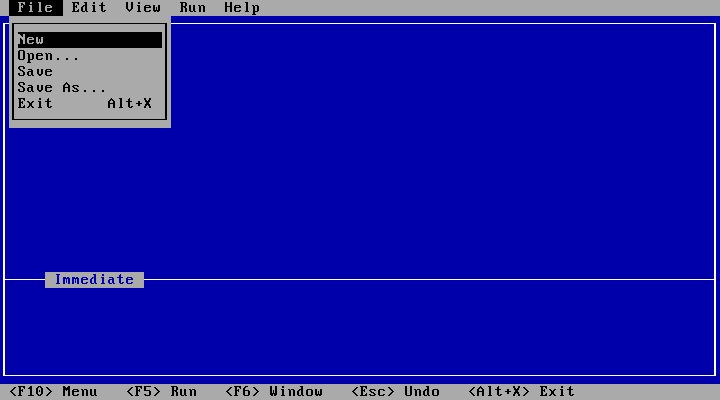
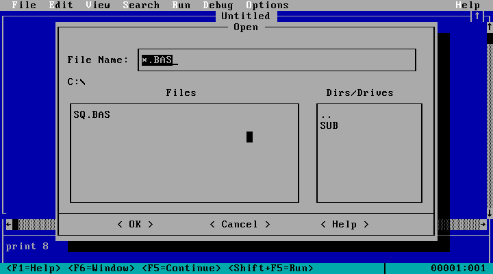
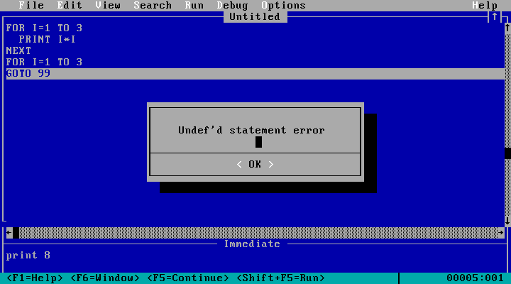

# x86 port

`make x86` builds `build/x86/basic.com`, a DOS `.COM`: 16-bit real mode, 386 operations, tiny
model, one translation unit (`src/x86/main.asm` includes the rest). Toolchain: jwasm and jwlink
(`LLRM_BIN`). The 6502 build is in `src/6502`.

## Layout

`src/x86/main.asm` holds startup and includes the rest in order:

- `vm/`: `isa.inc` the ops and CALL tables; `exec` data ops; `flow` jumps, FN, FOR; `calls`
  statement routines; `builtins` functions.
- `comp/`: `lex`; `comp` statements; `expr` expressions; `link` the link and the code cache;
  `list` LIST.
- `mem/`: `far` segments and linear addresses; `prog` the program store; `sym`; `str`; `arr`.
- `io/`: `io` console; `repl` errors and READY; `file`; `plat` DOS.
- `float/`: `flt` soft f32; `ftr` functions; `fpu` x87.

`def.inc` holds the constants, `data.inc` the variables, `gen.inc` the generated text. Op handlers
are `op_*`, CALL routines `sc_*`, function bodies `fn_*`.

## Float

f32: an IEEE single, s:1 e:8 f:23, in one dword. It is the widest of f8/f16/f24/f32, fits one 32-bit
register, and MUL, DIV and SHRD give its arithmetic directly. A narrower format saves no time on a
386 and loses digits. Output is 7 digits, stock's is 9, so non-integer prints can differ from stock.

## Types

Every value's type is known at compile time, so nothing checks one at run time. A plain variable is
a FLOAT and a `%` variable an INT. Integer literals under 32768 are INT.

INT op INT is INT, for + - * / and ^. `/` truncates: `7/2` is 3 and `1/3` is 0. A negative power
truncates too: `2^-1` is 0. Past -32768..32767 is ?OVERFLOW. FLOAT op INT or FLOAT is FLOAT. A
relation, `AND`, `OR` and `NOT` are INT. This differs from stock, where every number is a float.

`RUN` compiles every line to find the plain variables that only `FOR` assigns, with INT start,
limit and step. Those are INT in every expression, so `I/2` truncates, and past 32767 a loop raises
an error.

Any other `FOR` on a plain variable whose start, limit and step are whole and fit in an INT counts
in an INT, and stores the float on each `NEXT`. If the body writes the variable, that loop goes on
as a float loop, as in stock.

## FPU

`flt_finit` detects an x87 at start. With one, the float routines' entries jump to x87 versions;
each takes and returns a packed single, so the x87 stack is empty between ops.

`SQR` is `fsqrt`, `SIN` `fsin`, `COS` `fcos`, `TAN` `fptan`, `ATN` `fpatan`, `LOG` `fyl2x`, `INT`
`frndint`, `ABS` `fabs`. `EXP` and a fraction `^` take `f2xm1` and `fscale` at 64-bit precision. A
whole `^` under 256 is `fmul` squarings. INT to FLOAT is `fild`; FLOAT to INT is `fistp`, rounding
down as stock does. Every result is a single, so a stored result compares equal.

Soft and x87 rounding differ, so last digits can differ.

## Registers and memory

SI the code cursor in GS, DI the compiler's write pointer. The machine stack is the data stack:
every op pops its operands and pushes its result, in 4-byte cells (an INT in the low word, a FLOAT
as a single, a string as its descriptor's address). Handlers dispatch by `jmp`, so no return address
sits between ops. FOR, GOSUB and FN frames are on a separate control stack, each frame's first byte
its size.

CS holds the code; DS = SS starts at the code's end, CSOFF bytes up (the Makefile assembles twice
to learn it), and its image is moved there at start. The code cache sits in DS's free middle, which
CS reaches too: DS:x is CS:x+CSOFF.

| where | what |
|---|---|
| CS 0100h..CSOFF | the code |
| DS 0..CLIM | the data, then the code cache; CLIM is VARBASE, or CS's end if sooner |
| DS B000h..B400h | number variables, 4-byte slots |
| DS B400h..BC00h | string variables' Descs, 8-byte slots |
| DS BC00h..E000h | array headers |
| DS FC00h down | control stack |
| DS FFF0h down | data stack |
| FS = DS+1000h | PEEK and POKE's 64K |
| GS = DS+2000h | the direct line's header at 0, the program from 0110h |
| DS+3000h.. DOS's top | the heap: arrays up, strings down |

An array's header holds its counts and its data's segment; elements are reached through FS, and
the data may pass 64K. A string Desc is len:2 and a 32-bit linear pointer, so a string can sit in
the heap, the program or DS and hold up to 32767 chars, unlike stock's 255; LEFT$, RIGHT$ and MID$
take counts past 255. A string value on the data stack is its Desc's linear address. The
collector slides the live strings up to the heap's top.

A line is stored as its token body, as typed: `len:1 num:2 cp:2 body`. `cp` is the line's code in
the cache, 0 for none. The compiler makes bytecode in `xbuf`, and `cm_xlate` turns it into a
stream in the cache: the simple ops (loads, stores, INT and FLOAT operators, compares, IF, conversions,
NEXT of an INT variable, 1-D INT and FLOAT elements) as machine code, the rest `mov si,operands;
jmp handler`, the handler ending `jmp si` with SI moved to CS's view. Stream addresses are DS's.
The first run of a line translates it into the cache. When it is full every line loses its code and the
frames' ips become offsets in their lines' code, resolved when used; FN bodies are a line and an
offset. A string literal points into the line's body. The link, at RUN, before a direct GOTO and
after a chained LOAD, compiles every line to infer types, then empties the cache. Any edit
unlinks. A jump holds its line number and its line's address, found when it first runs. Variable
slots are fixed at compile time; arrays exist only at run time, so their code holds the id.

`LIST`, `SAVE` and `VERIFY` print the body: keywords from their tokens, the rest as typed. READ
scans the bodies for DATA statements, after a `:` or a line's start. A statement that does not
compile becomes an `ERR` op, raised when it runs.

PEEK, POKE, WAIT and SYS use the next 64K (FS = DS + 1000h), zeroed at start; SYS to a zero byte
returns at once. USR is ?ILLEGAL QUANTITY.

## Flat build

`make x86f` builds `build/x86/basic32.exe` from `src/x86f`: flat 32-bit under DOS/32A, an LE
behind `stub32a.exe` with `DOS32A.EXE` beside it, its banner off (`tools/x86d32a.py`). DOS/32A
and DOSBox are llrm's pinned builds. Bytecode only: each op the 16-bit build compiles to machine
code has a handler in `vm/bc.asm`. The 64K segments are `.data?` regions (`dsb`, `progb`,
`pokeb`, `cachb`); stored stream addresses stay 16-bit offsets from `cachb`.

Its dialect is QBasic. `basic32.exe FILE.BAS` loads the file a line at a time, runs it and exits;
with no file it is a prompt. Line numbers are optional; a label is `name:` at a line's start. A
line with no number is NONUM (FFFFh) in the store, never found by number.

Names are up to 40 letters, digits and dots, with a suffix `% & ! # $`. The lexer emits each as
`M_VAR len text nam`, its entry in the name table (`mem/sym.asm`); what a name is, the compiler
asks the tables, as QBasic's parser does. A variable is found by name, type and whether an array,
so `a` and `a()` are two, `b` and `b!` one. A name's type is its suffix, else its `DIM AS` or
`CONST` type, else the DEFtype of its first letter, SINGLE by default. Declarations go into the
table when their line is entered (`comp/decl.asm`), so earlier lines see them; DEFtype holds for
the whole program.

INT is 32-bit: INTEGER and LONG are one type, -2^31..2^31-1, past it ?OVERFLOW. `/` gives a
FLOAT, `\` and MOD an INT; a FLOAT stored to an INT rounds, a half to even.
PRINT zones are 14 columns, TAB counts from 1, `INPUT "p", x` prints no `?`.

Block statements are paired across lines before a run: `cm_blocks` (`comp/block.asm`) walks
every statement with a stack and gives each IF, ELSEIF, ELSE, SELECT, CASE, DO, LOOP, WHILE,
WEND, FOR and EXIT its targets, a line and a statement offset. A jump op holds its target and,
once run, the address it found: the target line's code, compiled if it has none, carries a map
of its statements' code offsets (`cm_xlate`). A one-line IF's ELSE jumps within its line. FOR
does not run its body when the start is past the limit.

SUB and FUNCTION are procedures (`g_prc`), found by the same pass. A name in one is its local
unless DIM SHARED, CONST, or SHARED in it; STATIC keeps one across calls. `PCALL` saves the
procedure's locals on a save stack and zeroes them, then binds the arguments; `PRET` restores
them and stores each parameter passed as a lone variable back to it (BYREF). A string moves
between a variable and its save slot by changing its heap block's owner. Inside a procedure a
statement frees only the temporaries above the call's (`tspb`). The control stack has 7 KB, the
data stack 32 KB.

An array keeps a lower bound per dimension after its counts; OPTION BASE sets the default.
`arr_free` drops an array: the headers and data after it slide down, and the headers' data
pointers, the string blocks' owners in the moved data, and the headers in `vt` and on the save
stack follow. REDIM frees the old array; a reference to it, such as the caller's array a SUB
was handed, then names the new one. ERASE frees a REDIM's array and zeroes any other. `PRET`
frees the procedure's local arrays.

A record is one zeroed block, its fields in order with no padding: INTEGER, LONG and SINGLE 4
bytes, DOUBLE 8, `STRING * n` n, a TYPE inline. `SHORT`, ours, is a 2-byte integer, so a record
can match QBasic's layout byte for byte; outside a record it is an INT. A record array is one block of
elements. `R.ADDR` or `RA.ADDR` pushes the record's address, and `FL.LD`, `FL.ST`, `SF.LD`,
`SF.ST` reach a field at an offset the compiler adds up; `a = b` is `R.COPY`. `STRING * n` pads
or cuts each store to n chars.

A data stack cell is 8 bytes; a DOUBLE fills one as an IEEE double on the x87. `D.*` ops round
each result to 53 bits, so a chain of operations can differ from BC, which keeps 80-bit
intermediates, in the last digit. DOSBox emulates the x87 with host doubles: powers of ten come
from an exact table, and LOG and EXP can differ in the last digit. EXP and `^` raise ?OVERFLOW past
2^32767.5, as BC does, and give infinity, printed `1.#INF`, below that. SIN, COS and TAN raise
?ILLEGAL QUANTITY past 2^31; SQR of a negative does not.

ON ERROR GOTO keeps the handler's line. An error then sets ERR, QBasic's number, and ERL, the
last line number at or before the failing line, and keeps where RESUME goes: the failing
statement and the next, found in the line's statement map. The handler runs on the failing
procedure's frames and data stack (each `PCALL` frame keeps where its data stack starts), so
RESUME NEXT goes on inside a FUNCTION called mid-expression. An error in the handler, ERROR n with
no handler, and ON ERROR GOTO 0 in the handler stop the program with the error's message,
UNPRINTABLE when the number has none.

Addresses are flat. VARPTR gives a variable's 4-byte linear address, SADD a string's chars', and
PEEK and POKE take one. VARSEG and SSEG are 0 and DEF SEG does nothing; each prints a warning on
standard error, with the file's line number.

A statement's syntax is a line of `GRAMMAR` in `tools/x86dfa.py`, its keyword one byte or
`FFh n`; its actions are compiler routines (lower case) or `CALL K_*` (`!NAME`). The QBasic
routines' `K_*` and their handlers are one list, `qbklist` in `vm/isa.inc`; a function is a row of
`g_xfn` in `comp/expr.asm`: its token, routine, argument kinds and result, with none or optional
`( )` for TIMER, DATE$, INKEY$, ERR and the like. `vm/sys.asm` has the clock, INKEY$, SLEEP,
COMMAND$ (the command line after the program's file, upper case) and ENVIRON, which changes a
copy of the environment taken at the start. `vm/bin.asm` has MKI$ to CVD and the MBF forms: MKI$
is 2 bytes. RND is QBasic's 24-bit generator, seeded 50000h; RANDOMIZE puts the DOUBLE's two high
words, xor-ed, into the seed's middle word.

All output and input go through channels, `io/chan.asm`. Channel 0 is the console; the others
are OPEN's files by number, a DOS handle and a 512-byte buffer each, or the devices SCRN:, CONS:
and NUL:. `io_putc` writes to the current output channel, so a new device, such as an editor
window, is a new channel kind. `io/fio.asm` has the file statements and functions. A RANDOM
file's record is a buffer of its own, which FIELD's strings point into; GET and PUT take a
variable's place and kind from the compiler's `va`. An INTEGER is 2 bytes in a file.

The flat build needs an x87: it has no soft float, and without one it says so and exits. Its float
routines are `float/fpu.asm`; `float/flt.asm` keeps the compares, conversions and number text.

`make x86f-ide` adds the editor, `src/x86f/ui`: `build/x86/ide32.exe`. Its state is `g_ui` in
`ui.asm`, structures in `ui/ui.inc`. `X86_IDE=build/x86/ide32.exe tools/x86ide_test.py` plays it.

The editor builds the program as a file loads, labels and all. Its debugger is QBasic's Debug
menu: Step (F8), Procedure Step (F10), Trace On, Toggle Breakpoint (F9), Clear All Breakpoints,
Set Next Statement, F7 to the cursor and Run, Restart. In the editor the compiler starts each
program statement with a `DBG` op (`vm/dbg.asm`); `basic32.exe` has none. `DBG` stops for a step,
a breakpoint at its line's first statement or F7's line, and with trace on hands its place to a
hook, `ui/dbg.asm`'s, which lights the statement a moment. A stop is a STOP: CONT goes on past the
`DBG`. Ctrl+Break in the editor becomes a step, so it too stops at a statement's start. A
breakpoint is a mark on its text line (`ui/text.asm`), moving with the line, given to the VM by
line number before each run. To light a statement the editor tokenizes its line again: the
statement map gives its body offset, the tokenizer's column map its column. TRON and TROFF set
trace; on their own they do nothing.

The windows (`ui/win.asm`) are QBasic's: Split, F6 and Shift+F6, Alt+Plus and Alt+Minus a row,
Ctrl+F10 the whole screen. Each has its rows from its height; the inactive edit window's state is
swapped in while it draws. Each procedure has its own view (`ui/view.asm`): the text keeps the
module's lines first, then each SUB or FUNCTION to its END, and a view is a range of its lines
that the text routines see as the whole (`tx_view`). Building the program and finding a line
work on the whole text. Typing a SUB or FUNCTION line in the module moves it to a view of its own
with its END; F2 lists the views, Shift+F2 and Ctrl+F2 step through them. View, Split
Vertically puts the second edit window beside the first, in its rows: each window has its own
first column and width.

The editor draws with attribute slots, not attributes; `ui/scr.asm` maps each through the theme
(`ui/theme.asm`). A theme is its attributes and the RGB of the 16 text colours, which go to the
DAC while the editor's screen shows: QBasic Colors keeps VGA's; One Dark and Light, Ayu Mirage
and Light, Gruvbox Dark Soft and Light, JetBrains Dark and Light take Zed's colours, over one
layout of the 16 so that they share their attributes. The program's screen always has VGA's. Syntax highlighting (`ui/syntax.asm`) tokenizes each
row with the compiler's lexer and colours each item from its column in the column map. Its
classes are Zed's: keywords, strings, numbers, comments, operators, types after `AS` or `TYPE`,
and the name a SUB, FUNCTION or DEF FN declares with its parameters.

Each `.asm` is a module of its own, linked by jwlink. They share `x86f.inc`: the model, the
constants, the macros, and `syms.inc`, the EXTERNDEFs `tools/x86syms.py` writes for every label
one module defines and another uses. `x86syms.py check` fails when `syms.inc` is stale or a
constant or macro two modules share is outside a header.

The core's state is one structure, `g_state` in `main.asm`, of a structure per part
(`state.inc`): `g_state.cm` the compiler, `g_state.rn` the executor, `g_state.io` input and
output, and so on. A buffer lives in the module that owns it. Every global's name starts `g_`.
`regions.asm` is linked last: the state zeroed at the start runs from `g_bss_s` to its `g_bss_e`.

Its lexer and statement parser are table-driven automata in `comp/dfa.inc`, generated by
`tools/x86dfa.py` and minimized. The scanner reads a whole word and gives the QBasic keyword it
spells, else it is a name: a token is 80h..FEh, or FFh and a byte. Each statement has a DFA built
from an LL(1) grammar, with the compiler's actions on its edges; expressions stay precedence
climbing. Listing spaces a line as QBasic's editor does.
`tools/x86f_test.py` holds its regressions. `tools/qbconf.py` runs llrm's qb45 suite and
`tests/run/qb` against it.

## Conformance

`tools/x86conf.py` runs the DOS build under llrm's dosbox-x:

- `conf` against stock's cached transcripts: 102 of 105 match, with and without an FPU. `pow_edges`
  differs by INT `^`: `2^16` is ?OVERFLOW. `str_errors` and `str_temps` by design: no ?STRING TOO
  LONG at 255, no ?FORMULA TOO COMPLEX at the fourth string temporary (48 fit, the data stack
  fills first).
  `tools/x86long_test.py` checks the longer strings and arrays, `tools/x86types_test.py` the
  static types, `tools/x86link_test.py` the link.
- `f32` against the 6502 build at `FP_BITS=32`, the same float and RND: 113 of 115 corpus programs
  match line for line, with INT `/` and `^` compiled as FLOAT. `55_life` fits here (11K arrays, the
  sim image has 7K); `70_poetry` never ends, so both runs are cut, at different lines. As built, 6
  more differ by INT division: `07_basketball`, `28_combat`, `37_ftball`, `81_splat`, `86_target`,
  `88_qubit`. `ByteSieve` too: the sim image is out of memory, the x86 build runs it. With an FPU
  16 differ: those, and float digits.
- `corpus` against stock, with an FPU: 39 match or are a prefix, 76 differ. 69 use RND, whose
  sequence is not stock's.

## Benches

`tools/x86conf.py bench`: instructions from dosrun's `end` event, program load to exit, DOS calls
included, `core=normal`. The virtual milliseconds are the instructions at 20 per microsecond, so
they say nothing more. The empty run is the startup cost.

    program                      instructions virtual ms  output
    (load, READY, exit)                 12417          3   [exit]
    empty FOR/NEXT x20000              693749         37  DONE [exit]
    arithmetic x5000                  1081428         56   10003  139 [exit]
    GOSUB + IF x5000                   932783         49   2499 [exit]
    array fill 20x500                 1085943         56   520 [exit]
    sieve N=500                        342254         20   95 [exit]
    FOR I% (stock I) x20000            692671         37  DONE [exit]
    arith, I% (stock I) x5000         1077996         56   10003  139 [exit]

Against the same programs, in 65C02 cycles (`tools/stock.py bench`, 6502 build at `FP_BITS=32`).
Instructions are not cycles, so the x86 figures above do not divide into these.

| program | stock | 6502 f32 |
|---|---|---|
| empty FOR/NEXT x20000 | 24,290,957 | 4,398,638 |
| arithmetic x5000 | 69,002,335 | 9,842,269 |
| GOSUB + IF x5000 | 51,384,718 | 7,045,557 |
| array fill 20x500 | 60,860,860 | 12,864,779 |
| sieve N=500 | 8,141,474 | 1,508,391 |
| FOR I% x20000 (stock: I) | 24,290,957 | 4,118,641 |
| arith, I% x5000 (stock: I) | 69,002,335 | 10,062,332 |

## Editor

`make ide` builds `build/x86/basic-ide.com` with `IDE=1`: a QBasic-style editor, about 11 KB more.
`BASIC NAME.BAS` opens a file. The code is in `src/x86/ui/`, one file per part: screen, text,
editing, drawing, menus, dialogs, sync.

The menus' status-bar help is in `BASIC.HLP`, read from the program's directory; without it the
lines are blank. Its lines follow the menu items in order, separators skipped.

The program is free-form text. Line numbers are optional and serve only as GOTO and GOSUB targets.
A line is capitalised and syntax-checked when the cursor leaves it. F5 numbers the unnumbered
lines (the previous number plus one), enters them, and runs. Output goes to page 1 until a key. A
runtime error or STOP puts the cursor on its line and shows a message box. F5 then
continues.

Keys work as in QBasic: Shift+arrows select, Shift+Del cut, Ctrl+Ins copy, Shift+Ins paste,
Ctrl+Y delete a line, Ins overtype, F6 the immediate window, F10 or Alt the menu bar, Ctrl+L
repeat the find. The WordStar keys work too: Ctrl+S, D, E, X, A, F, R, C, G, V, and Ctrl+Q then S,
D, R, C or Y. The menus, dialogs, message boxes, status lines and title bars follow QBasic's
source (MS-DOS 6.0, `qb5/uq` and COW in `beef/cw`): their places, sizes, colours and texts. Dialog
hotkeys light once Alt is pressed. With a mouse driver, clicks
work on menus, dialogs, the text (a drag selects), the scroll bar and the status bar's keys.
The screen is drawn off-screen and copied to video memory in the vertical retrace.
Tab completes the word at the cursor from what fits there: statements at a statement's start,
line labels after GOTO, GOSUB or THEN, variables after FOR or NEXT, functions and variables in an
expression, TO or THEN after an operand. An expression offers only names and functions of the
type it wants (`A$=` string ones), variables before functions. NEXT offers the open FOR's
variable; GOSUB lists first the lines after a RETURN, END, STOP or GOTO, each with its text. A
function gets its `(` and its form on the status bar; an array its `(`. Several matches show a
list. `make ide AC=0` leaves it out.
`tools/x86ide_test.py` plays it under DOSBox-X and writes `docs/img/ide-*.png`.

