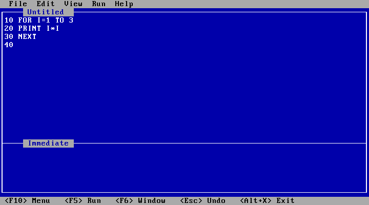

# x86 port

`make x86` builds `build/x86/basic.com`, a DOS `.COM`: 16-bit real mode, 386 operations, tiny
model, one translation unit (`src/x86/main.asm` includes the rest). Toolchain: jwasm and jwlink
(`LLRM_BIN`). The 6502 build is in `src/6502`.

## Layout

`src/x86/main.asm` holds startup and includes the rest in order:

- `vm/`: `isa.inc` the ops and CALL tables; `exec` data ops; `flow` jumps, FN, FOR; `calls`
  statement routines; `builtins` functions.
- `comp/`: `lex`; `comp` statements; `expr` expressions; `link` the link and the code cache;
  `list` LIST.
- `mem/`: `far` segments and linear addresses; `prog` the program store; `sym`; `str`; `arr`.
- `io/`: `io` console; `repl` errors and READY; `file`; `plat` DOS.
- `float/`: `flt` soft f32; `ftr` functions; `fpu` x87.

`def.inc` holds the constants, `data.inc` the variables, `gen.inc` the generated text. Op handlers
are `op_*`, CALL routines `sc_*`, function bodies `fn_*`.

## Float

f32: an IEEE single, s:1 e:8 f:23, in one dword. It is the widest of f8/f16/f24/f32, fits one 32-bit
register, and MUL, DIV and SHRD give its arithmetic directly. A narrower format saves no time on a
386 and loses digits. Output is 7 digits, stock's is 9, so non-integer prints can differ from stock.

## Types

Every value's type is known at compile time, so nothing checks one at run time. A plain variable is
a FLOAT and a `%` variable an INT. Integer literals under 32768 are INT.

INT op INT is INT, for + - * / and ^. `/` truncates: `7/2` is 3 and `1/3` is 0. A negative power
truncates too: `2^-1` is 0. Past -32768..32767 is ?OVERFLOW. FLOAT op INT or FLOAT is FLOAT. A
relation, `AND`, `OR` and `NOT` are INT. This differs from stock, where every number is a float.

`RUN` compiles every line to find the plain variables that only `FOR` assigns, with INT start,
limit and step. Those are INT in every expression, so `I/2` truncates, and past 32767 a loop raises
an error.

Any other `FOR` on a plain variable whose start, limit and step are whole and fit in an INT counts
in an INT, and stores the float on each `NEXT`. If the body writes the variable, that loop goes on
as a float loop, as in stock.

## FPU

`flt_finit` detects an x87 at start. With one, the float routines' entries jump to x87 versions;
each takes and returns a packed single, so the x87 stack is empty between ops.

`SQR` is `fsqrt`, `SIN` `fsin`, `COS` `fcos`, `TAN` `fptan`, `ATN` `fpatan`, `LOG` `fyl2x`, `INT`
`frndint`, `ABS` `fabs`. `EXP` and a fraction `^` take `f2xm1` and `fscale` at 64-bit precision. A
whole `^` under 256 is `fmul` squarings. INT to FLOAT is `fild`; FLOAT to INT is `fistp`, rounding
down as stock does. Every result is a single, so a stored result compares equal.

Soft and x87 rounding differ, so last digits can differ.

## Registers and memory

SI the code cursor in GS, DI the compiler's write pointer. The machine stack is the data stack:
every op pops its operands and pushes its result, in 4-byte cells (an INT in the low word, a FLOAT
as a single, a string as its descriptor's address). Handlers dispatch by `jmp`, so no return address
sits between ops. FOR, GOSUB and FN frames are on a separate control stack, each frame's first byte
its size.

| where | what |
|---|---|
| DS 0100h.. | the image, then the data |
| DS B000h..B400h | number variables, 4-byte slots |
| DS B400h..BC00h | string variables' Descs, 8-byte slots |
| DS BC00h..E000h | array headers |
| DS FC00h down | control stack |
| DS FFF0h down | data stack |
| FS = CS+1000h | PEEK and POKE's 64K |
| GS = CS+2000h | the direct line's header at 0, the program from 0110h |
| CS+3000h.. DOS's top | the heap: arrays up, strings down |

An array's header holds its counts and its data's segment; elements are reached through FS, and
the data may pass 64K. A string Desc is len:2 and a 32-bit linear pointer, so a string can sit in
the heap, the program or DS and hold up to 32767 chars, unlike stock's 255; LEFT$, RIGHT$ and MID$
take counts past 255. A string value on the data stack is its Desc's linear address. The
collector slides the live strings up to the heap's top.

A line is stored as its token body, as typed: `len:1 num:2 cp:2 body`. `cp` is the line's code in
the cache, 0 for none. The compiler makes bytecode in `xbuf`, and `cm_xlate` turns it into a
stream in CS: the simple ops (loads, stores, INT and FLOAT operators, compares, IF, conversions,
NEXT of an INT variable, 1-D INT and FLOAT elements) as machine code, the rest `mov si,operands;
jmp handler`, the handler ending `jmp si`. The first run of a line translates it into the cache,
CS from the end of the data to `VARBASE`. When it is full every line loses its code and the
frames' ips become offsets in their lines' code, resolved when used; FN bodies are a line and an
offset. A string literal points into the line's body. The link, at RUN, before a direct GOTO and
after a chained LOAD, compiles every line to infer types, then empties the cache. Any edit
unlinks. A jump holds its line number and its line's address, found when it first runs. Variable
slots are fixed at compile time; arrays exist only at run time, so their code holds the id.

`LIST`, `SAVE` and `VERIFY` print the body: keywords from their tokens, the rest as typed. READ
scans the bodies for DATA statements, after a `:` or a line's start. A statement that does not
compile becomes an `ERR` op, raised when it runs.

PEEK, POKE, WAIT and SYS use the next 64K (FS = CS + 1000h), zeroed at start; SYS to a zero byte
returns at once. USR is ?ILLEGAL QUANTITY.

## Conformance

`tools/x86conf.py` runs the DOS build under llrm's dosbox-x:

- `conf` against stock's cached transcripts: 102 of 105 match, with and without an FPU. `pow_edges`
  differs by INT `^`: `2^16` is ?OVERFLOW. `str_errors` and `str_temps` by design: no ?STRING TOO
  LONG at 255, no ?FORMULA TOO COMPLEX at the fourth string temporary (48 fit, the data stack
  fills first).
  `tools/x86long_test.py` checks the longer strings and arrays, `tools/x86types_test.py` the
  static types, `tools/x86link_test.py` the link.
- `f32` against the 6502 build at `FP_BITS=32`, the same float and RND: 113 of 115 corpus programs
  match line for line, with INT `/` and `^` compiled as FLOAT. `55_life` fits here (11K arrays, the
  sim image has 7K); `70_poetry` never ends, so both runs are cut, at different lines. As built, 6
  more differ by INT division: `07_basketball`, `28_combat`, `37_ftball`, `81_splat`, `86_target`,
  `88_qubit`. `ByteSieve` too: the sim image is out of memory, the x86 build runs it. With an FPU
  16 differ: those, and float digits.
- `corpus` against stock, with an FPU: 39 match or are a prefix, 76 differ. 69 use RND, whose
  sequence is not stock's.

## Benches

`tools/x86conf.py bench`: instructions from dosrun's `end` event, program load to exit, DOS calls
included, `core=normal`. The virtual milliseconds are the instructions at 20 per microsecond, so
they say nothing more. The empty run is the startup cost.

    program                      instructions virtual ms  output
    (load, READY, exit)                 12417          3   [exit]
    empty FOR/NEXT x20000              693749         37  DONE [exit]
    arithmetic x5000                  1081428         56   10003  139 [exit]
    GOSUB + IF x5000                   932783         49   2499 [exit]
    array fill 20x500                 1085943         56   520 [exit]
    sieve N=500                        342254         20   95 [exit]
    FOR I% (stock I) x20000            692671         37  DONE [exit]
    arith, I% (stock I) x5000         1077996         56   10003  139 [exit]

Against the same programs, in 65C02 cycles (`tools/stock.py bench`, 6502 build at `FP_BITS=32`).
Instructions are not cycles, so the x86 figures above do not divide into these.

| program | stock | 6502 f32 |
|---|---|---|
| empty FOR/NEXT x20000 | 24,290,957 | 4,398,638 |
| arithmetic x5000 | 69,002,335 | 9,842,269 |
| GOSUB + IF x5000 | 51,384,718 | 7,045,557 |
| array fill 20x500 | 60,860,860 | 12,864,779 |
| sieve N=500 | 8,141,474 | 1,508,391 |
| FOR I% x20000 (stock: I) | 24,290,957 | 4,118,641 |
| arith, I% x5000 (stock: I) | 69,002,335 | 10,062,332 |

## Editor

`make ide` builds `build/x86/basic-ide.com` with `IDE=1`: a QuickBASIC-style full-screen editor,
about 1.7 KB more, started only when standard input and output are both the console. Page 0 is the
editor (menu bar, program window, immediate window, status bar); page 1 is the program's output,
shown for F5 (RUN) and for an immediate line, until a key. The program is listed as LIST prints
it, one line at a time in an edit buffer that goes to `rpl_enter` when the cursor leaves it. Enter
adds a line ten on (or between); a number alone deletes. Keys: arrows, Home, End, PgUp, PgDn, Del,
Backspace, Esc (undo the line), F6 or Tab (other window), F5, Alt+X. `tools/x86ide_test.py` plays
it under DOSBox-X and writes `docs/img/ide-*.png`. The menus: File (New, Open, Save, Save As,
Exit), Edit (undo line, delete line), View, Run (Start, Continue), Help. Open, Save and New are
run as `LOAD"NAME.BAS"`, `SAVE"..."`, `NEW` on the output page; when they print nothing the editor
comes straight back, else the message waits for a key.

