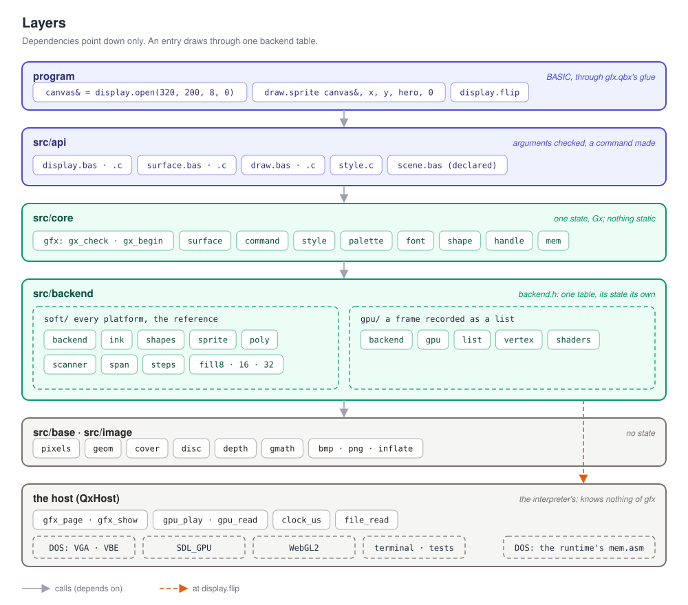
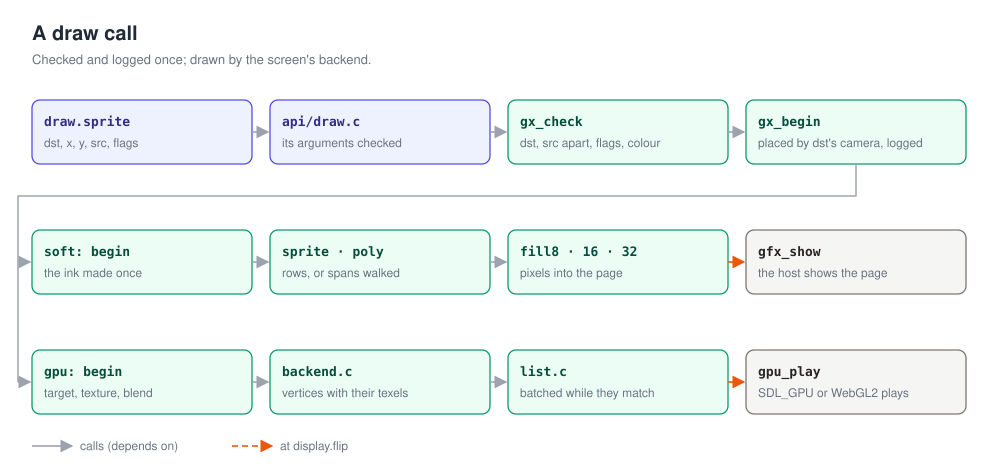

# gfx architecture

How `src/` is laid out and why. The API is the interfaces in [src/api](../src/api). The rules every
backend keeps are in [design.md](design.md).

## Goals

- **One state, clear owners.** `Gx` (`core/gfx.h`) holds every part's state. Each module takes only
  its own part. Nothing is static but the state's pointer, and memory is the host's, taken on first
  use.
- **One way to draw.** An entry draws through the screen's `Backend` table. It never asks which
  backend that is.
- **Clean boundaries.** An entry checks and records, the core places, and a backend draws. See
  [Boundaries](#boundaries).
- **Open/closed.** A backend is a new table. A draw call is an entry, a command kind and a backend
  op.
- **DRY and SRP.** There is one edge walk, one span pipeline and one texel walk, and each module has
  one job.
- **Software is the reference.** It runs on every platform, and a GPU draws what it draws.

## Layers



## Layout

| Directory | Owns | Does |
|---|---|---|
| `src/api` | | The interfaces (`*.bas`) and their entries: arguments checked, a command made, the backend called |
| `src/core` | `Gx`, `Surfaces`, `Fonts`, `Palette`, `Style`, `CmdLog` | The state, handles, surfaces and views, palette tables, fonts, `draw`'s settings, commands and the frame's log, pictures' corners |
| `src/backend` | `Backend` | `backend.h`, the table every backend fills |
| `src/backend/soft` | `Soft` | The software renderer: inks, the scanner, the span pipeline, fillers by format |
| `src/backend/gpu` | `GpuState` | The GPU renderer: a frame recorded as a list the host plays, and the one shader |
| `src/base` | | Pixel formats and colour maths, geometry, the pixel rule, discs, depth values, maths |
| `src/image` | | BMP and PNG to pixels; PNG's inflate |
| `src/platform/dos` | | What the DOS slice lacks: `memcpy` and `memset` |

## Boundaries

- **An entry checks, records and dispatches.** It checks its arguments, makes a `Command`, begins
  the call and calls the backend's ops. It draws no pixel.
- **`gx_check` has no effects.** It checks dst, a source apart from it, the flags and the colour,
  and takes dst's camera and clip. A refused call draws nothing and logs nothing.
- **`gx_begin` places and logs.** It places the command by the camera, adds the style's numbers,
  logs it, and readies the backend.
- **The core knows the backend's table, never a backend.** Nothing in `src` outside `backend/soft`
  and `backend/gpu` includes their headers; only their own tests do.
- **A backend keeps its own state** in `Gx.own`. It makes it on first use and frees it in `stop`.
  `gx_use` switches backends.
- **A source never shares its destination's pixels.** That means the same surface, or views of one:
  a GPU cannot sample the texture it draws into.
- **A function's name starts with its owner's prefix**: `gx_`, `surf_`, `cmd_`, `pal_`, `font_`,
  `hdl_`, `style_`, `soft_`, `span_`, `scan_`, `gpu_`, `img_`.

## A draw call



1. The entry checks its arguments and makes a `Command`: its kind, points, source, flags and
   colour.
2. `gx_check` checks the destination and the source, the flags and the colour. It takes the
   destination's camera and clip.
3. `gx_begin` places the command and logs it. `display.get_drawn` reads that log, the same on every
   backend. Then the backend's `begin` readies the call.
4. The entry calls the backend's ops: `sprite`, `poly`, `rect` and the rest.
5. Software draws at once into the page the host lent, and `display.flip` shows it (`gfx_show`). A
   GPU adds vertices to the frame's list, batched while target, texture, blend and clip match.
   `display.flip` ends the list, and the host plays it (`gpu_play`).

## Software

- **The ink** (`ink.c`) is made once a call, from its flags and the style. It says what a texel
  goes through: the key, a solid colour, at 8 bits the light, palette and blend tables, at 15 to 32
  bits a shade and a blend mode.
- **The scanner** (`scanner.c`) walks a convex polygon's two edge chains down from its top vertex,
  one walk for affine and perspective. It clips each span once and keeps gfx's pixel rule
  (`base/cover.h`).
- **The span pipeline** (`span.c`) draws every textured span along a walk over the picture's texels
  (`steps.h`). The target's fused filler draws it when the ink has nothing to do. Otherwise chunks go
  through the ink when the walk stays inside the picture and there is no depth. Otherwise it goes a
  pixel at a time: the texel held inside, keyed, depth-tested, drawn, and its depth set. A
  perspective span is runs of 16 pixels between two divides. `SMOOTH` goes a pixel at a time too,
  mixing the four texels round it as the GPU's shader does.
- **The fillers** (`fill.c`) are a table for each format: rows copied, keyed and flipped, flat
  spans, and the ink's chunks. Each filler is one body, compiled for each format.
- **Depth** is 1/z in 16 bits, a buffer for each root surface, made on its first `DEPTH_TEST` or
  `DEPTH_WRITE` draw.

## GPU

- `backend.c` turns shapes and pictures into triangles. A shape is `SOLID`, so it joins any batch.
- `gpu.c` records the frame: textures made and sent, rows the CPU wrote sent again, pipelines,
  passes, clips and reads back.
- `list.c` writes the list the host plays (`src/qx/qxlist.h`): its words, vertices, indices and
  batches.
- The one shader is in `shaders/`. `make shaders` crosses it into SPIR-V, MSL and ESSL
  (`shaders.h`).
- The host plays the list on the interpreter's thread (SDL_GPU) or on the page's (WebGL2).
  [design.md](design.md#backends) says why gfx records a list.

## The package

`gfx.qbx` holds a table of interfaces, each a module's name and source, over one slice a platform.
The modules share the surfaces, the style and the recorder.

- `IMPORT gfx.draw` looks for `gfx/draw.bas`, `gfx/draw.qbx`, then `gfx.qbx`'s part `draw`.
- There is one `qx_init_gfx`. An entry is named with its module, `draw.sprite`, and so is a type.
- The glue (`tools/qbx.py`) reads every interface of the package: C functions such as
  `gfx_draw_sprite`, records such as `gfx_draw_vertex`. It joins a DECLARE's `_` lines, and no C
  name can meet the C library's.
- The file format's version is 2. A version 1 file is one unnamed interface.

## Tests

- `tests/*_test.c` call the entries by name (`CALL("draw.sprite", ...)`) on a fresh state. They
  assert on the commands logged and on the pixels read back.
- `tests/gpu_test.c` drives the GPU backend against a fake host and checks the list it records.
- `tools/gfx_test.py --sums` checksums a test scene at each depth. It is the pixel-identity check
  across refactors, and between the host and DOS.
- `tests/host/gfx.sh` runs BASIC programs through `gfx.qbx`.

The diagrams come from `tools/diagrams/gfx.py`:

```bash
cd tools/diagrams && python3 gfx.py ../../stdlib/gfx/docs/img
```
